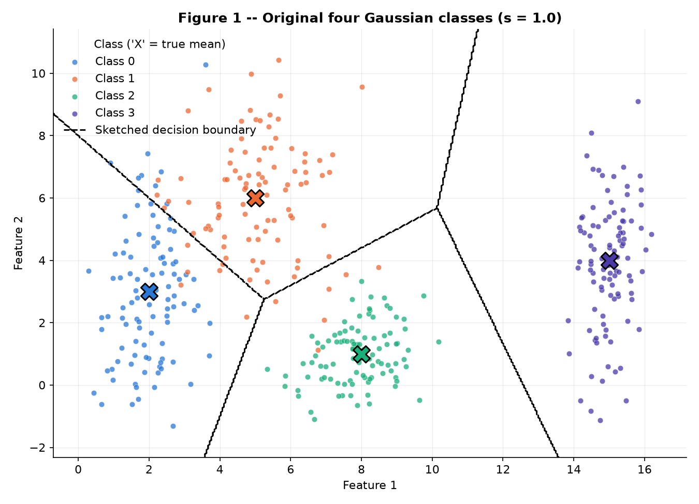
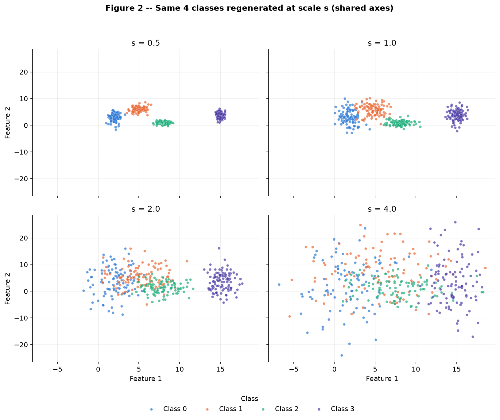
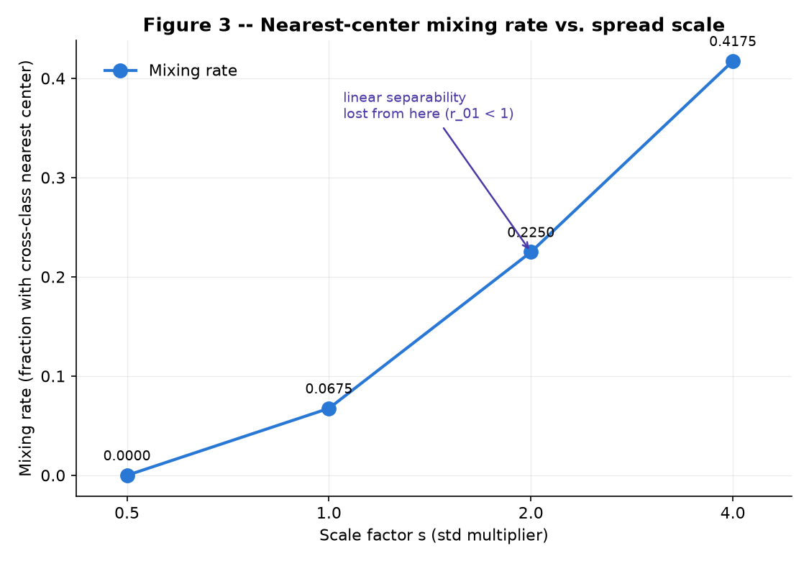
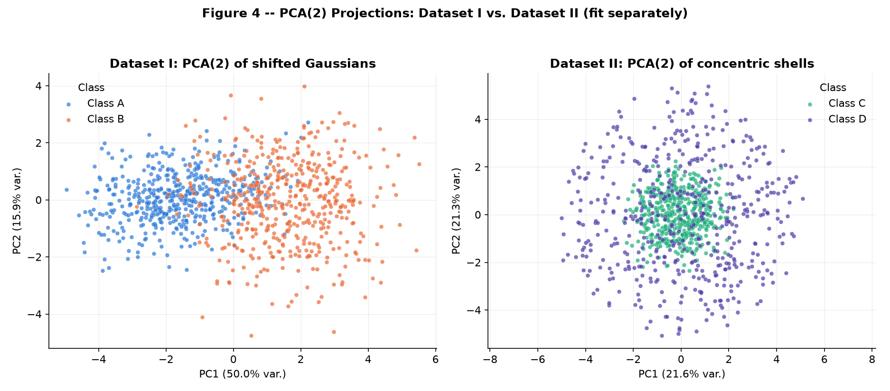
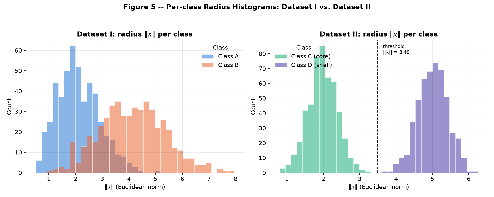
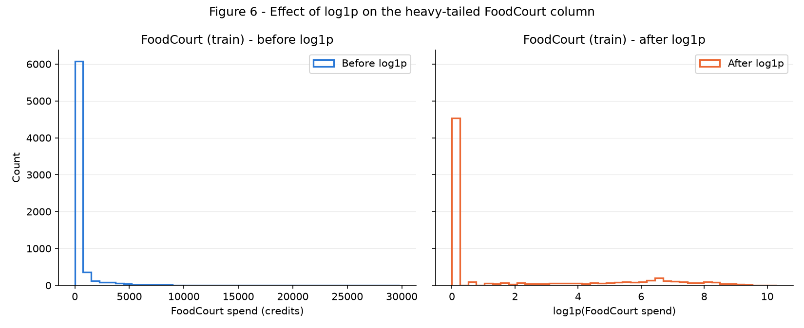

Three exercises, one question: when can a straight line separate two classes?

The answer turns on a single ratio — how far apart the class centres sit, divided by how
much each class spreads around its own centre. Exercise 1 measures that ratio in 2D and
watches four Gaussian clouds dissolve into each other as the spread grows. Exercise 2
breaks it on purpose in 5D, with one dataset whose classes differ in *location* and one
whose classes differ only in *radius*, where no hyperplane helps at all. Exercise 3 takes
the same idea to a real table, where spread shows up as heavy-tailed spending columns that
have to be compressed before a `tanh` network can use them.

Nothing here is trained. Every measurement is geometric or descriptive. Exercises 1 and 2 each
draw everything from one `np.random.default_rng(42)` created at the top of their script, and
Exercise 3's only random step, the stratified split, uses the same seed (`random_state=42`, since
scikit-learn's splitter takes an integer seed, not a generator).

!!! tip "The figures are interactive"
    Hover any point or bar for its value, click a legend entry to isolate or hide a class,
    and drag or scroll to zoom where points overlap. Figure 5 also has a slider that moves
    the decision threshold and reports the resulting accuracy as you drag it.

## Exercise 1

### A — Generate the clouds

Four 2D Gaussian classes are drawn, 100 points each, 400 points in total. One generator,
`rng = np.random.default_rng(42)`, supplies every draw. Its stream is used in class order 0
through 3, one `rng.normal(mean, std, size=(100, 2))` call per class. Nothing else draws from it
beforehand. The
parameters are Class 0: mean `[2, 3]`, std `[0.8, 2.5]`; Class 1: mean `[5, 6]`, std `[1.2, 1.9]`;
Class 2: mean `[8, 1]`, std `[0.9, 0.9]`; Class 3: mean `[15, 4]`, std `[0.5, 2.0]`.

Figure 1 plots all 400 points colored by class, with each class's true generative mean marked by a
large outlined marker. Class 0 and Class 1 sit close enough that their clouds touch along a thin border.
Class 2 is the tightest and most symmetric of the four; its std `[0.9, 0.9]` is the only isotropic
one. Class 3 sits alone far along the first axis, around `x = 15`.

<div class="chart chart--tall" data-chart="fig1" markdown="span"></div>

### B — More or less spread out

**1.** The four classes are regenerated four separate times, once per scale factor
`s ∈ {0.5, 1.0, 2.0, 4.0}`. Each regeneration multiplies every class's standard deviation by `s`
and leaves every mean where it is. The result is four independent 400-point datasets, not one
dataset with mixed scales. These draws continue the same `rng` stream in increasing order of `s`,
with no re-seeding.

Figure 2 shows the four datasets in a 2×2 grid on identical x/y limits, so the growth in spread is
comparable panel to panel. At `s = 0.5` the clusters are small and disjoint. At `s = 2.0` Classes
0, 1 and 2 have merged into one elongated cloud while Class 3 stays a separate island. At
`s = 4.0` all four classes interpenetrate across most of the plotted region.

<div class="chart chart--tall" data-chart="fig2" markdown="span"></div>

**2.** The separation ratio `r_ij = ||μ_i − μ_j|| / (σ̄_i + σ̄_j)`, where `σ̄_k` is the mean of class
`k`'s two per-axis standard deviations, is computed for all 6 pairs at `s = 1.0` directly from the
class parameters. It never touches the random generator.

| Pair | ‖μ_i − μ_j‖ | σ̄_i + σ̄_j | r_ij |
|---|---|---|---|
| (0, 1) | 4.2426 | 3.20 | **1.3258** |
| (0, 2) | 6.3246 | 2.55 | 2.4802 |
| (0, 3) | 13.0384 | 2.90 | 4.4960 |
| (1, 2) | 5.8310 | 2.45 | 2.3800 |
| (1, 3) | 10.1980 | 2.80 | 3.6422 |
| (2, 3) | 7.6158 | 2.15 | 3.5422 |

The smallest ratio is **r₀₁ = 1.3258, between Class 0 and Class 1**, the tightest margin of the
six pairs: their means are only about 1.33 times as far apart as the sum of their average
per-axis spreads. Since every mean is held fixed and only spread is scaled, `r_ij` scales as `1/s`. At
`s = 2.0` the smallest ratio becomes **r₀₁ = 1.3258 / 2 = 0.6629**, by arithmetic on the `s = 1.0`
value, with nothing regenerated.

**3.** The mixing rate is the fraction of the 400 points whose nearest of the 4 true class
**centers** is not their own class's center. Distance is Euclidean from each point to each class
**mean**, not to another data point, computed as a vectorized `argmin` over a point-to-center
distance matrix. Nothing is fit and nothing is trained. The results: `s = 0.5` → **0.00%**
(0/400), `s = 1.0` → **6.75%** (27/400), `s = 2.0` → **22.50%** (90/400), `s = 4.0` → **41.75%**
(167/400).

**4.** Figure 3 plots the mixing rate against `s`. At `s = 0.5` the rate is 0.00%: every point
already lies closer to its own class's center than to any other, so Figure 1's Voronoi cells
assign every point to its true class and straight lines separate the four clouds cleanly. At
`s = 1.0` the rate is 6.75%, small but no longer negligible, and most of it comes from the
Class 0 / Class 1 border where `r₀₁` is smallest.

Separation is decisively lost **from `s = 2.0` onward**. The rate more than triples to 22.50%, a
**3.33×** jump, at exactly the scale where the smallest ratio crosses below 1. `r₀₁ = 0.6629` says
the two closest means are now nearer to each other than their combined average spread, so no
straight line can keep either cloud on its own side. By `s = 4.0` the rate reaches
41.75%: more than four in ten points are now closer to another class's center than to their own.

<div class="chart chart--short" data-chart="fig3" markdown="span"></div>

### C — Analysis

**1.** A single straight line cannot separate the four classes. A set of straight lines almost can.

One cut splits the plane in two. With four classes arranged around the plane (0 upper-left, 1
upper-middle, 2 lower-middle, 3 far right), at least two of them always land on the same side of
any single line.

The piecewise-linear Voronoi partition of the 4 fixed means gives one straight boundary per
adjacent pair of classes. At `s = 1.0` it keeps the large majority of points on the correct side:
the nearest-center mixing rate is only 6.75% (27/400) on the `s = 1.0` dataset of item B, and
5.00% (20/400) on the 400 points plotted in Figure 1, which are the separate item-A draw. It fails
in the strip where Classes 0 and 1 physically interleave, by far the closest pair. `r₀₁ = 1.3258` sits well below every other
pairwise ratio, which is why Figure 1 shows Classes 2 and 3 sitting in their own clean regions
while 0 and 1 share a border.

**2.** That partition is sketched directly on **Figure 1** as the dashed lines: the
perpendicular-bisector boundaries a nearest-centroid rule draws between each pair of adjacent class
means. It is the simplest straight-line rule consistent with four Gaussian blobs at fixed centers,
and the boundary a trained network would most plausibly settle near. It is the same nearest-center
rule that produced the mixing rate in B.3, evaluated on a dense grid instead of only the 400
sampled points.

**3.** The sketched boundary lines never move. Scaling inflates each class's covariance by `s` and
leaves every mean fixed, and the dashed lines are built only from the means. What grows is the
share of each Gaussian's probability mass sitting on the wrong side of a line
that no longer shifts to compensate. The mass a Gaussian puts beyond a fixed line at distance `d` from its mean is `Φ(−d/σ)`. It
stays near zero while `σ` is small next to `d`, then climbs steeply once `σ` approaches `d`. So
the sliver near each boundary, where a class's own tail crosses into a
neighboring cell, widens sharply. Doubling `s` from 1.0 to 2.0 takes the mixing rate from 6.75% to
22.50% (**3.33×**), and at `s = 4.0` that error region holds 41.75% of all points. Figure 1's
dashed lines are the boundary a network learns once. Figures 2 and 3 show how much of the data that
fixed boundary gets wrong as the classes grow more overlapped.

```python
--8<-- "docs/exercises/data/code/ex1_point_clouds.py"
```

## Exercise 2

### A — Dataset I: shifted Gaussians

Dataset I is two correlated Gaussian blobs in 5D, 500 samples per class. Both are drawn with
`rng.multivariate_normal(mean, cov, size=500)` from one seeded generator,
`rng = np.random.default_rng(42)`, class A first and class B second. Class A has mean `[0, 0, 0, 0, 0]`. Its covariance sets a strong positive correlation of
`0.8` between features 1–2, then chains `0.3`, `0.5` and `0.2` through features 2–3, 3–4 and 4–5.
Class B sits at mean `[1.5, 1.5, 1.5, 1.5, 1.5]` with 1.5× the variance on every
axis. Its leading covariance flips sign to `-0.7` (a correlation of -0.47 once divided by the
variance 1.5), and the downstream chain becomes covariances `0.4`, `0.6`, `0.3`. Both matrices also
carry a weak feature 1–3 term, `0.1` in A and `0.2` in B.

The empirical centroids land at `[0.026, 0.085, 0.037, 0.019, 0.035]` for A and
`[1.489, 1.499, 1.450, 1.458, 1.524]` for B, both within sampling noise of their generative means.

The class signal here is a location difference: B sits where A does not.

### B — Dataset II: concentric shells

Dataset II is two concentric spherical shells in 5D, 500 samples per class. Each point gets a
direction drawn uniformly on the unit 5-sphere and a class-specific
radius `ρ`. The directions come from sampling `v ~ N(0, I_5)`, one row per point, with
`rng.standard_normal((500, 5))` and normalizing each row, `u = v / ‖v‖`. The point is then `x = ρ·u`. Class C, the core, uses `ρ ~ N(2.0, 0.4)`.
Class D, the shell, uses `ρ ~ N(5.0, 0.4)`.

Direction carries zero class information: it is drawn from the same distribution for C and D, so
only the scalar radius differs between classes. The class signal here is a magnitude, not a location.

The `rng` stream continues after Dataset I in a fixed order: each class's directions before its
radii, core (C) before shell (D), so the script is reproducible from the single seed.

### C — Visualize and compare

**Figure 4** projects each dataset to 2D with its own `PCA(n_components=2, svd_solver="full")`,
fitted separately, never pooled into a shared PCA. The `"full"` solver is exact, adding no randomness.

For **Dataset I**, PC1 explains **50.04%** of the variance and PC2 a further **15.93%**, a combined
**65.97%**. The classes split along PC1 in the left panel, A on the left and B on the right, with a
band of overlap in the middle (roughly |PC1| < 2); the A→B mean shift lines up with the dominant
direction of variance.

For **Dataset II**, PC1 and PC2 explain **21.59%** and **21.32%**, a combined **42.91%**, close to the 20% each axis would carry under uniform variance. The right panel
shows C and D as two overlapping circular clouds with no dominant direction.

**The 2D projection preserves classification-relevant structure far better for Dataset I than for
Dataset II.** The explained-variance gap (65.97% vs. 42.91%) follows from what PCA can see. Dataset
I's signal, a mean shift, is linear. Dataset II's signal, a radius, is not — PCA's linear map
cannot see it.

<div class="chart" data-chart="fig4" markdown="span"></div>

In the original 5D space, the distance between empirical class centroids is
**‖μ_A − μ_B‖ = 3.2282** for Dataset I and **‖μ_C − μ_D‖ = 0.2662** for Dataset II. The shell
centroids coincide: directions average out around the origin regardless of radius.

**Figure 5** shows the per-class distribution of the radius `‖x‖`, one panel per dataset, both
classes overlaid. For Dataset I the mean radius is **2.1085** for class A and **4.1284** for class B,
separated but with real overlap, a side effect of the mean shift, not the signal itself.
For Dataset II the mean radius is **1.9718** (std 0.3956) for class C and **5.0047** (std 0.4094) for
class D. The gap is **3.0328**, more than ten times the 5D centroid distance, and the two histograms
in the right panel barely touch.

<div class="chart" data-chart="fig5" markdown="span"></div>

### D — Analysis

**1.** No hyperplane can separate Dataset II, because the two classes share a center. A hyperplane
`wᵀx = b` is a *location* test: it projects each point onto a direction `w` and compares the result
to a threshold, which works only when the class means differ along some direction. Here they do not.
The centroids are 0.2662 apart while the radius histograms are almost disjoint. For almost every
class-C point near a candidate hyperplane there is a same-radius class-C point on the far side, and
likewise for D, because direction is drawn identically for both classes: the problem is trivial in
*magnitude* and empty in *location*.

**2.** More data does not help, because the obstruction is geometric, not statistical. Fix any
hyperplane and rotate a training point `ρ·u` around the sphere at constant radius: it stays in its
class throughout, yet it can end up on the other side of that hyperplane. Direction is uniform and
independent of class, so a hyperplane through the origin splits each class half and half by
symmetry, whatever the radius. Moving the hyperplane off the origin only trades one class's errors
for the other's: it keeps the core on one side only by sending most of the shell to that same side,
so no position removes both kinds of error. These are properties of the two distributions, not of
any sample, so they hold at every sample size: more data only sharpens the error estimates, and the
error rates themselves do not change. The boundary that does separate C and D is a sphere,
`‖x‖ = 3.4883` (see D.3), a shape no single hyperplane can represent — not in the raw coordinates,
and not after any linear rotation of them, PCA included.

**3.** No. A mixed-looking 2D linear projection proves only that the classes are inseparable by a
linear boundary confined to that particular 2D subspace. It says nothing about the full 5D space or
about non-linear boundaries. PCA is itself a linear map, so it can only surface structure that a hyperplane could already exploit. A
mixed-looking projection is consistent with either genuine inseparability or a non-linear boundary
PCA cannot express.

Dataset II is the second case. Its panel in Figure 4 looks mixed, and no hyperplane separates its
raw coordinates (Parts D.1–D.2), yet a single non-linear feature separates it perfectly:
`f(x) = ‖x‖² = Σᵢ xᵢ²`. Put the threshold at the midpoint of the two class mean radii,
`‖x‖ = (1.9718 + 5.0047) / 2 = 3.4883`, which gives **f(x) = ‖x‖², classify as Class C (core) if
f(x) < T ≈ 12.17, else Class D (shell)**. Applied to all 1000 points of Dataset II it is **100.00%**
correct, and dragging the threshold slider on Figure 5 shows a wide band of thresholds around
3.4883 holding at 100%. The inseparability visible in the PCA plot is an
artifact of PCA's linearity, not a property of the data.

```python
--8<-- "docs/exercises/data/code/ex2_nonlinearity_5d.py"
```

## Exercise 3

### A — Get to know the data

The Kaggle "Spaceship Titanic" `train.csv` holds 8,693 passenger rows and 14 columns. The target is
`Transported`, a boolean recording whether that passenger was moved to an alternate dimension during
the collision. The two classes are close to even: 4,378 passengers True (50.36%) against 4,315 False
(49.64%).

!!! note "Re-running this exercise"
    `train.csv` is Kaggle's file and the competition rules forbid redistributing it, so it is
    **not committed** (`docs/exercises/data/code/data/` is git-ignored). Download `train.csv` from the
    [Spaceship Titanic data page](https://www.kaggle.com/competitions/spaceship-titanic/data), save it
    as `docs/exercises/data/code/data/train.csv`, then run `python ex3_spaceship_titanic.py` from
    `docs/exercises/data/code/`; if the file is missing the script stops and prints this same
    instruction. Exercises 1 and 2 need no input file.

Six features are numerical: `Age`, `RoomService`, `FoodCourt`, `ShoppingMall`, `Spa`, `VRDeck`. Four
are categorical: `HomePlanet`, `CryoSleep`, `Destination`, `VIP`. Three further columns are
identifiers or free text and get dropped in Part C: `Cabin`, `Name`, `PassengerId`.

Twelve of the 14 columns carry missing values, all of them inside a narrow 2.06%–2.50% band; only
`PassengerId` and the target `Transported` are complete. No column is dominated by missingness:

| Column | Missing count | Missing % |
|---|---|---|
| CryoSleep | 217 | 2.50% |
| ShoppingMall | 208 | 2.39% |
| VIP | 203 | 2.34% |
| HomePlanet | 201 | 2.31% |
| Name | 200 | 2.30% |
| Cabin | 199 | 2.29% |
| VRDeck | 188 | 2.16% |
| FoodCourt | 183 | 2.11% |
| Spa | 183 | 2.11% |
| Destination | 182 | 2.09% |
| RoomService | 181 | 2.08% |
| Age | 179 | 2.06% |
| PassengerId | 0 | 0.00% |
| Transported | 0 | 0.00% |

Mean, median and max for each spending column, full dataset (missing values skipped), with the
standard deviation, the skewness and the share of exact zeros as measures of spread:

| Column | Mean | Median | Max | Std | Std / mean | Skew | % zeros |
|---|---|---|---|---|---|---|---|
| RoomService | 224.69 | 0.00 | 14327.00 | 666.72 | 2.97 | 6.33 | 65.52% |
| FoodCourt | 458.08 | 0.00 | 29813.00 | 1611.49 | 3.52 | 7.10 | 64.11% |
| ShoppingMall | 173.73 | 0.00 | 23492.00 | 604.70 | 3.48 | 12.63 | 65.85% |
| Spa | 311.14 | 0.00 | 22408.00 | 1136.71 | 3.65 | 7.64 | 62.56% |
| VRDeck | 304.85 | 0.00 | 24133.00 | 1145.72 | 3.76 | 7.82 | 64.61% |

Every spending column has a median of exactly 0.00 and a mean between 173.73 and 458.08. Most
passengers spend nothing on a given service (62.56%–65.85% of the non-missing values are exactly
0), and a small minority spend up to tens of thousands of credits, which drags the mean well above
the median. The spread is wide: the standard deviation, 604.70–1611.49, is 2.97–3.76 times the mean
of its own column, and a skewness of 6.33–12.63 (0 for a symmetric distribution) confirms a long
right tail. That gap is heavy right skew, and it is what motivates the `log1p` step in Part C.

### B — Split before you transform

The split comes first: 80/20, stratified on `Transported`, seed 42, giving 6,954 training rows and
1,739 test rows. No imputer, encoder or scaler runs before it. The positive-class share lands at
0.5036 on train and 0.5037 on test, so the stratification held the original balance on both sides.

The order matters because imputers and scalers *learn* a statistic from whatever they are fitted on:
a median, a mode, a min and a max. Fit them on the full table and the test rows' values enter the
numbers used to transform the training data. Any score measured afterwards is inflated by
information the model was never supposed to have. Fitting every transformer on train and applying
the fitted transform to test keeps the test split a genuine stand-in for unseen data, so held-out
performance stays an honest estimate.

### C — Preprocess

**Missing data.** Numerical columns are imputed with the train median, categorical columns with the
train mode. The median suits the five spending columns because they are heavily skewed, as Part A
shows: a mean would sit far above the typical value, which is zero. For `Age` it is the usual robust
default. The mode is the natural default for a handful of discrete labels. Both `SimpleImputer`
instances are fit on the training split and applied to test. Zero NaNs remain in either split
afterwards.

**Categorical encoding.** `HomePlanet`, `CryoSleep`, `Destination` and `VIP` go through
`OneHotEncoder(handle_unknown="ignore")`, fit on train, producing 10 binary columns. The
`handle_unknown="ignore"` setting decides what happens to a category that appears only in test: the
encoder emits an all-zero block for that passenger instead of raising. The pipeline never crashes on
an unseen value, and it never has to peek at test to learn its categories in advance.

**Feature engineering.** `TotalSpend` is the row-wise sum of the five spending columns, computed
after imputation so no NaN can enter the sum. `Cabin`, `Name` and `PassengerId` are dropped as
identifiers and free text with no reusable predictive signal.

**Heavy tails.** `log1p` is applied to the five spending columns and to `TotalSpend`. It fits no
parameter, so it carries no leakage risk in either order, but its position is still fixed: after
imputation, before scaling. The numbers below are for `FoodCourt` on the training split. The raw
column (154 missing values skipped, n = 6,800) has mean 452.61 and median 0.00; after median
imputation, which is the column Figure 6 plots (n = 6,954), the mean is 442.59 and the median 0.00.
`log1p` cuts the maximum from 29,813 to 10.30 and the skewness from 7.38 to 1.16. It does not make
the column symmetric: 65.30% of the rows are exactly 0 and `log1p(0) = 0`, so they stay a spike at 0.
The other 34.70% (2,413 passengers) spread over roughly 1–10 in a symmetric-looking hump, skewness
-0.44. Part D shows the effect.

**Why `log1p` helps a tanh network.** Min-max scaling the raw column to [-1, 1] puts 92.52% of the
training rows below -0.9 and leaves a standard deviation of only 0.1064: 1,893 of the 2,413 spenders
(78.5%) are squeezed into the bottom 5% of the interval together with the zeros, while a thin tail
of large spends stretches out to +1. A tanh unit then receives almost the same input for nine rows
in ten. Telling those rows apart needs a weight of order 10 on this feature (they all lie within 0.1
of -1), and with such a weight the few large spenders, up to 2 units away, land deep in tanh's
flat tails, where the gradient `1 − tanh²(z)` is close to zero. A single unit cannot keep both the
crowded bulk and the far tail in its responsive range. After `log1p` the scaled standard deviation
is 0.5670, no spender falls below -0.9 (0 of 2,413; the 65.30% below -0.9 are the exact zeros,
sitting at -1), and the spenders spread over the rest of the interval, so a moderate weight is
enough to tell rows apart without saturating any of them. This is an argument about the input
distribution; no network is trained in this activity.

**Scaling.** The seven numerical columns (`Age`, the five log-transformed spending columns, and
`TotalSpend`) are scaled with `MinMaxScaler(feature_range=(-1, 1))`, fit on train. Normalization to
[-1, 1] was chosen over standardization because tanh's own output range is exactly [-1, 1], while a
standardized column is unbounded and a single outlier row can land far outside it. Train comes out
at exactly [-1.00, 1.00], bounded by construction since the scaler was fit on it. Test comes out at
[-1.00, 1.14]: `ShoppingMall` and `VRDeck` each hold at least one test passenger more extreme than
anything seen in training. That is expected, leakage-free behavior, not a bug: the scaler only ever
learned train's min and max.

### D — Verify and visualize

Figure 6 shows the `FoodCourt` column on the train split before and after `log1p`. It is the
imputed column (n = 6,954), the one the transform actually receives.

<div class="chart" data-chart="fig6" markdown="span"></div>

The raw distribution is a single spike near zero with a sparse tail running out to nearly 30,000
credits, which is the mean 442.59 against median 0.00 gap made visible. After `log1p` the tail is
pulled in (maximum 10.30) and the spenders spread over roughly 1–10 in a symmetric-looking hump, but
the 65.30% of rows that spent nothing remain a tall spike at 0: the transform compresses the tail,
it cannot split the zeros.

The final checks pass. Zero NaNs remain in either split (0 in train, 0 in test). The training
feature matrix has shape `(6954, 17)`: 7 scaled numerical columns plus 10 one-hot columns. The test
matrix matches at `(1739, 17)`. Training values span exactly [-1.00, 1.00], the interval tanh itself
outputs into; test spans [-1.00, 1.14], for the reason given in Part C.

**Range check: compatible with tanh.** The overshoot comes from two test columns only. `ShoppingMall`
peaks at 1.138 and `VRDeck` at 1.035; every other test column stays at or below 0.953 (`Age` 0.949,
`RoomService` 0.882, `FoodCourt` 0.933, `Spa` 0.934, `TotalSpend` 0.953), and every column reaches
-1.000 at its minimum. The worst case is 0.138 beyond the training interval, and `tanh(1.138) = 0.81`,
so even that value, passed straight through a tanh, comes out short of the ±1 plateau.

The decision most likely to affect training is the `log1p` transform on the spending columns.
Median and mode imputation, one-hot encoding and the choice of scaling interval all move numbers
around without changing the shape of the distribution a hidden unit sees. `log1p` changes the shape.
Without it, scaling `FoodCourt` to [-1, 1] puts 92.52% of the rows below -0.9 (standard deviation
0.1064) with a thin tail of outliers out to +1; with it, the standard deviation is 0.5670 and the
spenders spread across the interval. The consequence is the trade-off of Part C: to separate the
crowded bulk a tanh unit needs a large weight, and that weight pushes the outliers into the flat
region where gradients vanish, so the network would lose either the bulk or the tail. `log1p` removes
the trade-off by bringing the bulk and the tail to a comparable scale. All five spending columns
share the pattern that motivates it (medians of 0, 62.56%–65.85% zeros, skewness 6.33–12.63; Part A),
which is why the same transform goes on every one of them and on `TotalSpend`. The zero spike
itself survives it, so the network will still see "spent nothing" as one distinct value.

```python
--8<-- "docs/exercises/data/code/ex3_spaceship_titanic.py"
```

## Results summary

| # | Item | Your value |
|---|---|---|
| 1 | Mixing rate at s=0.5 | 0.0000 (0/400) |
| 2 | Mixing rate at s=1.0 | 0.0675 (27/400) |
| 3 | Mixing rate at s=2.0 | 0.2250 (90/400) |
| 4 | Mixing rate at s=4.0 | 0.4175 (167/400) |
| 5 | Smallest r_ij at s=1.0, and which pair | 1.3258, Class 0 vs Class 1 |
| 6 | Distance between centers — Dataset I | 3.2282 |
| 7 | Distance between centers — Dataset II | 0.2662 |
| 8 | Explained variance PC1+PC2 - Dataset I | 0.6597 (0.5004 + 0.1593) |
| 9 | Explained variance PC1+PC2 - Dataset II | 0.4291 (0.2159 + 0.2132) |
| 10 | Share of the positive class in Transported | 0.5036 (train) / 0.5037 (test) |
| 11 | Mean and median of FoodCourt on the training set, before transforming | 452.61 / 0.00 (raw train, 154 NaN skipped); 442.59 / 0.00 after median imputation |
| 12 | Final shape of the training feature matrix | (6954, 17) |
| 13 | Minimum and maximum of the training and test sets after scaling | Train: [-1.00, 1.00] / Test: [-1.00, 1.14] |
