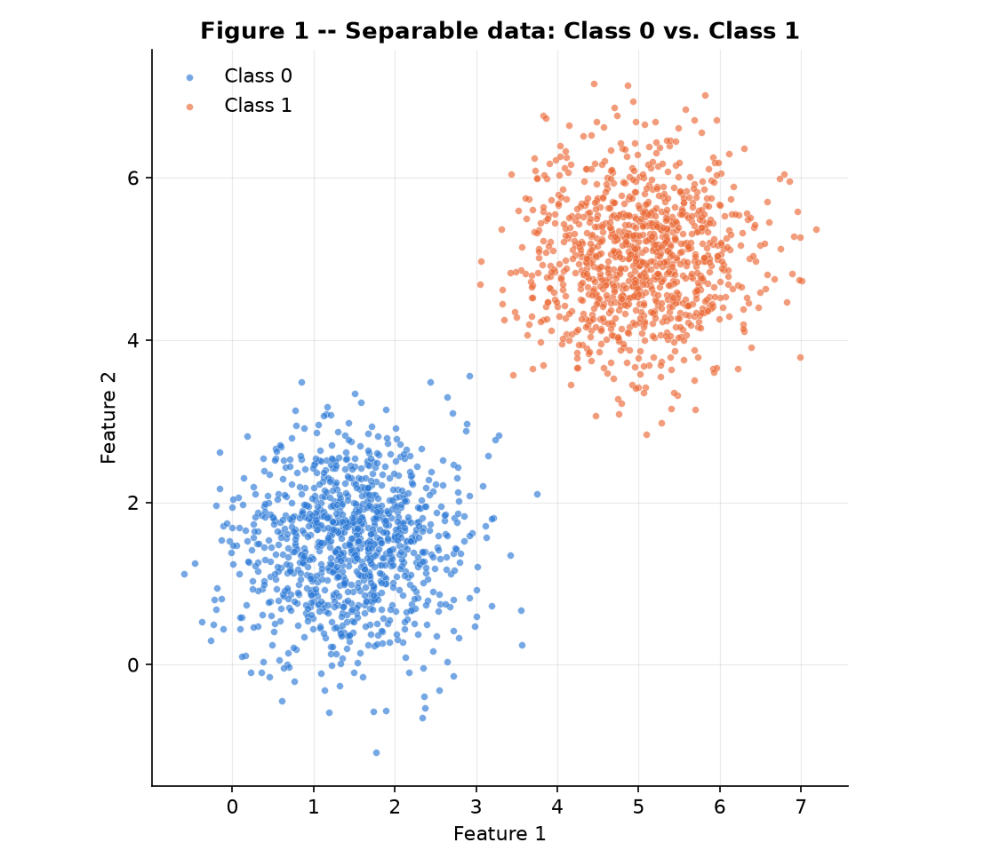
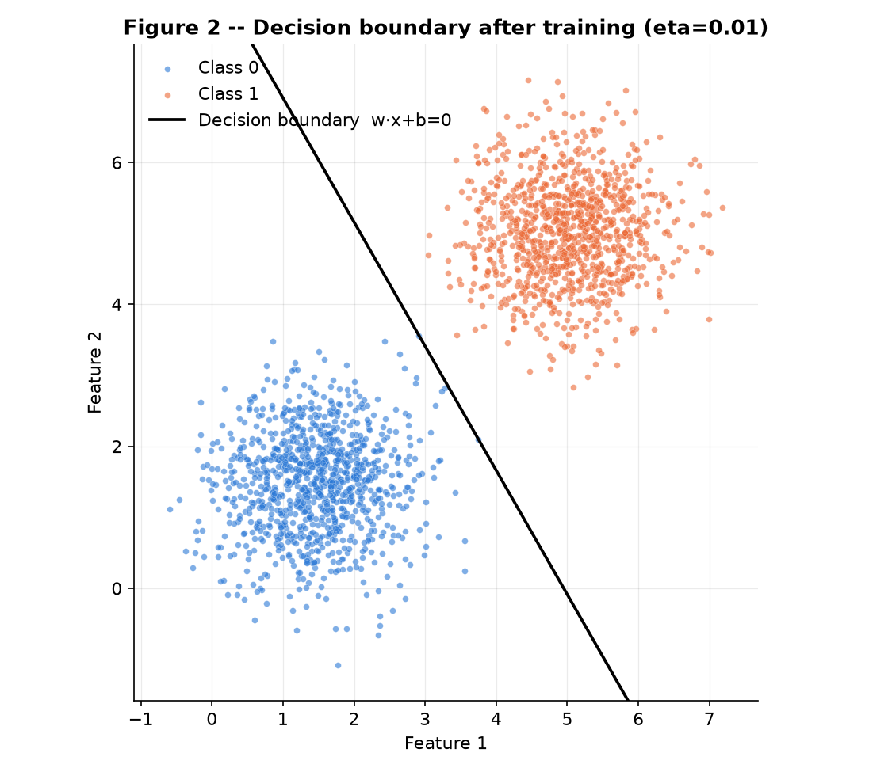
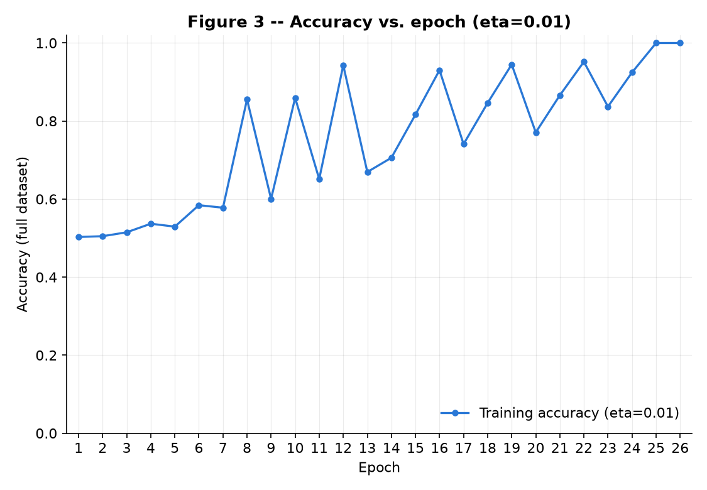
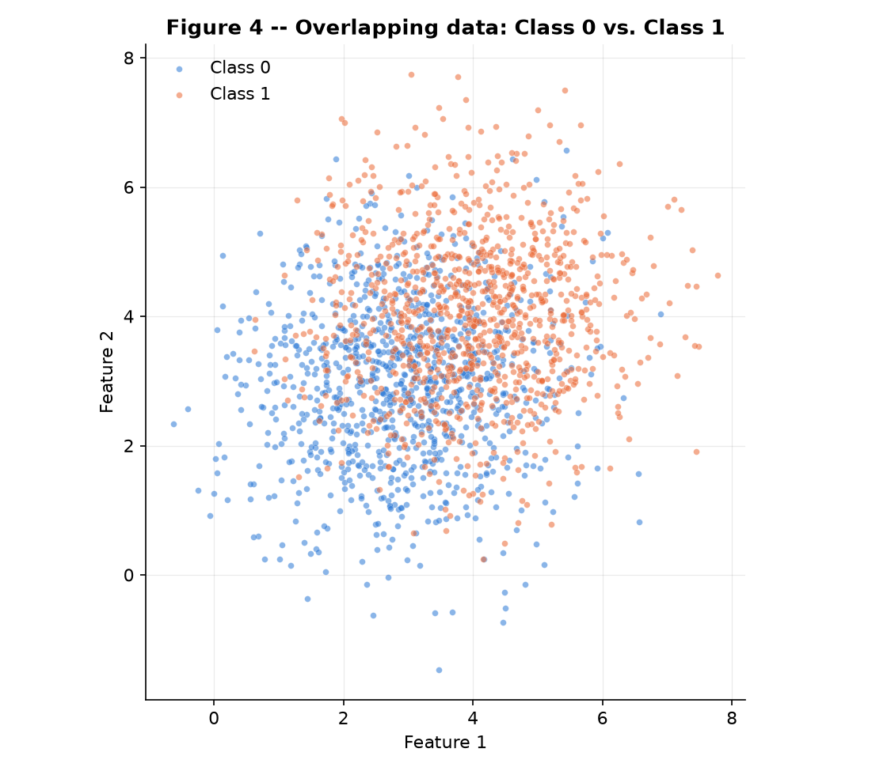
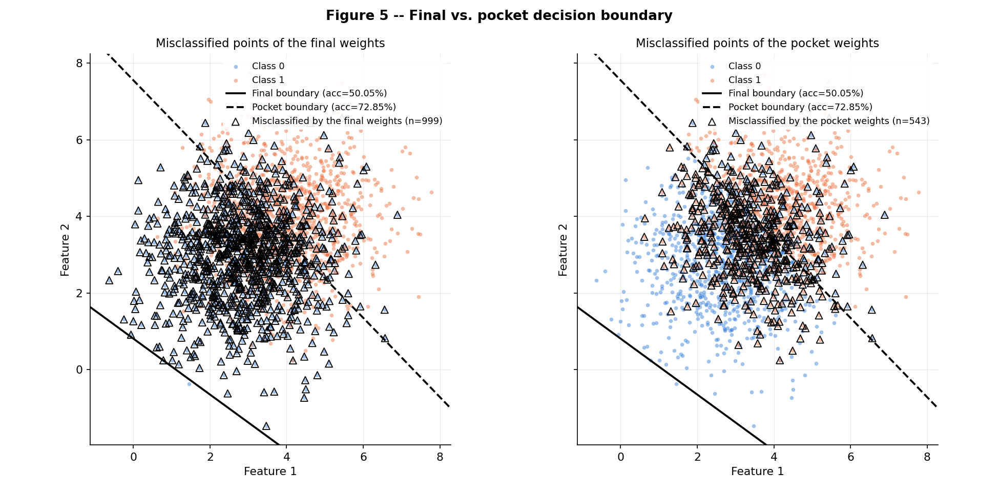
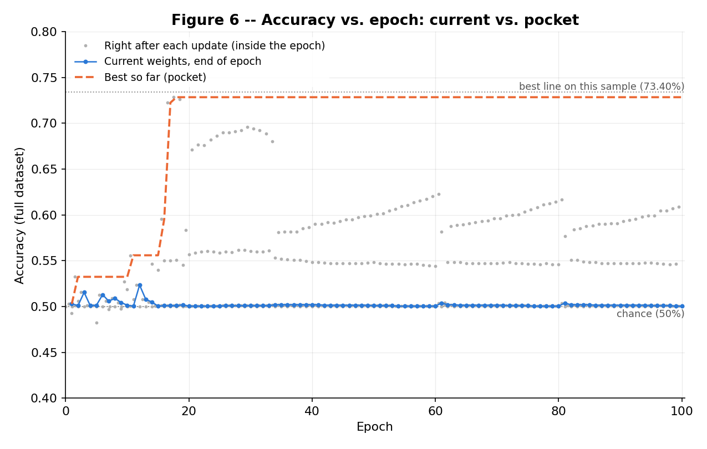

This report trains the same from-scratch perceptron on two different datasets to contrast what
happens when a linear boundary can and cannot fit the data. Exercise 1 uses a widely-separated,
linearly separable pair of Gaussian classes, where the plain perceptron reaches 100% accuracy after
only 73 updates. Exercise 2 uses a heavily overlapping pair, where no separating hyperplane exists
and the plain update rule never converges — motivating the pocket algorithm, which tracks the
best-so-far weights instead of trusting whatever the last epoch happened to leave behind.

## Exercise 1

### A — Generate the data

Two classes are drawn as 2D Gaussians, 1000 points each (2000 total), from the single seeded
generator `rng = np.random.default_rng(42)`, consumed in class order — Class 0 first, then
Class 1 — via `rng.multivariate_normal(mean, cov, size=1000)`, no other draw happening before
these two. Class 0: mean `[1.5, 1.5]`, covariance `[[0.5, 0], [0, 0.5]]`; Class 1: mean
`[5, 5]`, covariance `[[0.5, 0], [0, 0.5]]` — both isotropic with per-axis std
`√0.5 ≈ 0.7071`. **Figure 1** plots all 2000 points, one color per class. The two clouds sit
far apart relative to their own spread: the distance between means is
`‖μ₁ − μ₀‖ = √(3.5² + 3.5²) = 3.5√2 ≈ 4.9497`, about **7 standard deviations** along the line
joining them, so — consistent with the exercise's own sanity check — the two classes are, for
all practical purposes, linearly separable, with no visible overlap. (The sample is separable with
a small but positive margin: along the line joining the means, the last Class-0 point and the first
Class-1 point are `0.3856` apart, `0.55σ`.)



### B — Implement the perceptron

The shared, from-scratch `Perceptron` class (`perceptron.py`, no scikit-learn — numpy only) is
the single implementation Exercise 2 will import and reuse unchanged. It follows the spec
exactly: prediction `yhat = step(w·x + b)` with `step(z) = 1` if `z ≥ 0` else `0`; the online,
per-sample update `w ← w + eta·(y − yhat)·x`, `b ← b + eta·(y − yhat)`, applied inside a plain
Python loop over samples (never batched/vectorized, since the rule is defined per example);
init `w = rng.normal(0, 0.01, size=2)`, `b = 0`; and stopping at the first of "a full epoch
with zero updates" or `max_epochs` epochs. Full-dataset accuracy at the current `(w, b)` is
recorded after every epoch (`history`), and so is the number of updates made in that epoch
(`updates`).

The class also carries, from the start, the one thing Exercise 2 adds to the loop: the pocket copy.
Right after each update it scores the new `(w, b)` on the full dataset and, if that accuracy is
strictly higher than any seen so far (the initial weights count as seen), copies `(w, b)` into
`pocket_w`, `pocket_b` (and the epoch into `pocket_epoch`). The final weights stay in `w`, `b`, so a
single `fit` returns both sets. The pocket only *reads* `(w, b)`: the update lines run identically
with or without it, so none of the Exercise 1 numbers depends on it. Here the pocket simply ends
equal to the final weights, because the last update of a converged run is the one that reaches
100% (the script asserts it). The code is embedded in full below.

### C — Train and measure

Training at the spec's standard `eta = 0.01` converges in **26 epochs** (a full pass with zero
updates on epoch 26), reaching **100.00% accuracy** (0/2000 points misclassified) on the full
dataset. The final parameters are **w ≈ [0.0505, 0.0289]**, **b ≈ −0.2500**. **Figure 2** draws
the resulting boundary `w·x + b = 0` over the data; with zero misclassified points there is
nothing to mark, and the line cleanly separates every Class 0 point (lower-left) from every
Class 1 point (upper-right), consistent with the gap between the clouds seen in Part A. **Figure 3**
plots accuracy against epoch: it starts at 50.30% after epoch 1 (the small-random `w₀` init is
close to an arbitrary line through the origin, and the 3 updates of that epoch have not changed
that: 994 of the 2000 points are still misclassified) and then zigzags upward — 85.6% at epoch 8,
60.1% at epoch 9, 86.0% at epoch 10, 65.1% at epoch 11, 94.3% at epoch 12, and so on — reaching
100% at the end of epoch 25; epoch 26 is the zero-update pass that confirms it, comfortably inside
the 100-epoch cap. The zigzag is explained in Part D.1.





### D — Analysis

**D.1 — Why does separable data converge quickly?** The update only ever fires when
`yhat ≠ y`, so *the number of updates in an epoch is the number of mistakes made during that
pass*. A pass with zero updates leaves `(w, b)` untouched, so every later pass would make none
either: "a full pass with zero updates" is an absorbing state, and it is exactly the statement
"the current hyperplane classifies all 2000 points correctly." That the run must reach it is the
perceptron convergence theorem (stated in Exercise 2, D.2): when the classes are separable with a
margin `γ > 0` and the inputs are bounded by `R`, the *total* number of mistake-driven updates over
the whole run — not per epoch — is at most `(R/γ)²`, so mistakes cannot go on forever. A positive
margin exists here: along the line joining the means the two clouds are `0.3856` apart (Part A), so
a line halfway between them is at least `0.19` from every point. The bound is a ceiling, not a
prediction, and the run needs far less. The number of updates in each of the 26 epochs at
`eta = 0.01` is

`[3, 3, 4, 4, 3, 4, 3, 4, 2, 4, 2, 4, 2, 3, 3, 3, 2, 3, 3, 2, 3, 3, 2, 3, 1, 0]`

— **73 updates in total** (77 at `eta = 1.0`), i.e. 73 mistakes in 26 × 2000 = 52,000 sample
presentations. The count does not shrink smoothly: it stays at 2–4 per epoch for 24 epochs, drops
to 1 in epoch 25 and to 0 in epoch 26, and epoch 1 — 3 updates — still ends with 994 of the 2000
points misclassified (50.30% accuracy).

The 26 epochs, and the zigzag of Figure 3, come from the order of the data, not from its
difficulty. The points are fed as generated — 1000 Class-0 samples, then 1000 Class-1 samples — so
inside a block every mistake is of the same kind (false positives in the first block, false
negatives in the second) and its corrections push the line the same way until the block is
classified correctly; 69 of the 73 updates fall within the first 100 samples of their block, so an
epoch is a short burst of corrections at the start of each block. Each correction is large next to
the weights it changes: it moves `w` by `eta·‖x‖`, about 0.02 for a Class-0 point (`‖x‖ ≈ 2.1`) and
0.07 for a Class-1 point (`‖x‖ ≈ 7.1`), while `‖w‖` is only 0.058 at the end of the run. A single
update can therefore swing the accuracy by tens of points — the largest swing in the run is one
update, in epoch 12 at sample 69, that takes it from 99.95% to 50.00% — and the accuracy at the end
of an epoch is simply the state the last burst left the line in (85.6% at epoch 8, 60.1% at epoch
9, 86.0% at epoch 10, 65.1% at epoch 11, 94.3% at epoch 12, …), with the good epochs creeping
upward until the line lands in the gap with no mistake left and the pass of epoch 26 makes no
update. The same 2000 points presented in shuffled order (8 repetitions, fresh initialization each)
converge in 2–7 epochs, with 22–107 updates in total, 22–64 of them in the first epoch, and the
updates per epoch then fall to zero within one to six more epochs: it is the layout of the data,
not its separability, that stretches the run to 26 epochs.

**D.2 — Effect of `eta = 1.0` vs. `eta = 0.01`.** Re-running training with only `eta` changed
to `1.0` converges in **28 epochs** to **100.00% accuracy**, giving final parameters
**w ≈ [5.0515, 2.4970]**, **b ≈ −25.0000** — essentially the `eta = 0.01` solution scaled up by
~100×. Comparing normalized directions, `w/‖w‖` is **[0.8681, 0.4963]** at `eta = 0.01` and
**[0.8965, 0.4431]** at `eta = 1.0`; their cosine similarity is **0.9982**, i.e. the two runs
converge to nearly the same separating line. This is exactly what the update rule predicts:
the initial weights have magnitude `‖w₀‖ = O(0.01)`, but each fired update adds
`eta·(y − yhat)·x` to `w`, and the feature coordinates here live in the range ~1–7, so a single
update changes `w` by roughly `eta·‖x‖`. At `eta = 1.0` that is a jump of magnitude ~2–7 —
hundreds of times `‖w₀‖` — so the random init is swamped after the very first update and the
trajectory is governed almost entirely by the sequence of misclassified points. At
`eta = 0.01` a single update only moves `w` by ~0.02–0.07, a few times `‖w₀‖`, so the tiny
random init has a slightly larger (though still small) relative sway in the first update or two
before the accumulated corrections dominate — which is precisely why the two epoch counts (26
vs. 28) and the two directions are close but not numerically identical. In short, `eta` is a
**step-size / scale** knob: it rescales how far each correction moves `(w, b)` and, secondarily,
how quickly the accumulated updates overwhelm the fixed random start — it is not, on data this
separable, a knob that changes *which* line the perceptron converges to.

**D.3 — From `w = 0, b = 0`, `eta` only rescales the trajectory.** Starting both runs from
*exactly* zero and presenting them the identical sample sequence, induction on the
sample-presentation index `t` shows `w_t^eta = eta·w_t^1` and `b_t^eta = eta·b_t^1` for every
`eta > 0`, where `(w_t^1, b_t^1)` is the `eta = 1` trajectory. Base case: both sides are the
zero vector regardless of `eta`, and the very first prediction is forced to agree across every
`eta` because `z₀ = 0` for all of them and `step(0) = 1` by convention. Inductive step: if
`w_t^eta = eta·w_t^1` and `b_t^eta = eta·b_t^1` holds, then
`z_t^eta = w_t^eta·x_t + b_t^eta = eta·(w_t^1·x_t + b_t^1) = eta·z_t^1`; since `eta > 0`,
multiplying by it never changes the sign of `z_t^1` (nor the `≥ 0` boundary), so
`step(z_t^eta) = step(z_t^1)` — both runs predict identically at every step. If that
prediction is correct, neither run updates and the invariant carries over unchanged; if it is
wrong, both apply `w_{t+1}^eta = w_t^eta + eta·(y_t − yhat_t)·x_t = eta·[w_t^1 + (y_t −
yhat_t)·x_t] = eta·w_{t+1}^1` (and likewise for `b`), so the invariant extends to `t + 1`. By
induction it holds for all `t`. Three consequences follow: (1) since the two runs predict
identically at every step, they make mistakes on exactly the same steps, so **the epoch
count is identical for every `eta`**; (2) at the shared terminal step `T`, the boundary
`{x : w_T^eta·x + b_T^eta = 0} = {x : eta·(w_T^1·x + b_T^1) = 0}` reduces (dividing by
`eta ≠ 0`) to `{x : w_T^1·x + b_T^1 = 0}`, the **same hyperplane** regardless of `eta`; and (3)
applying the relation to two arbitrary rates against the common `eta = 1` reference gives
`w_t^{eta2} = (eta2/eta1)·w_t^{eta1}` (and likewise for `b`) at every step — running the whole
training twice from `w = 0, b = 0`, once with `eta1` and once with `eta2`, produces final
weights that differ only by the constant factor `eta2/eta1`, so the decision boundary and the
epoch count are identical and `eta` has no effect beyond scale. This is the idealized case:
it depends on `w₀ = 0` exactly so that `z₀ = 0` independent of `eta`, which is why the real,
nonzero-random-init runs in D.2 only converge to nearly — not exactly — proportional
trajectories, with the small discrepancy in epoch count (26 vs. 28) being the residual trace
of that broken symmetry.

```python
--8<-- "docs/exercises/perceptron/code/perceptron.py"
```

```python
--8<-- "docs/exercises/perceptron/code/ex1_separable.py"
```

## Exercise 2

### A — Generate the data

Two classes are drawn as 2D Gaussians, 1000 points each (2000 total), from the single seeded
generator `rng = np.random.default_rng(42)`, consumed in class order — Class 0 first, then
Class 1 — via `rng.multivariate_normal(mean, cov, size=1000)`, exactly as in Exercise 1. Class 0:
mean `[3, 3]`, covariance `[[1.5, 0], [0, 1.5]]`; Class 1: mean `[4, 4]`, covariance
`[[1.5, 0], [0, 1.5]]` — both isotropic with per-axis std `√1.5 ≈ 1.2247`. **Figure 4** plots all
2000 points, one color per class. Unlike Exercise 1, the two clouds sit *close together* relative
to their own spread: the distance between means is `‖μ₁ − μ₀‖ = √(1² + 1²) = √2 ≈ 1.4142`, under
**1.2 standard deviations** apart, so the classes visibly interpenetrate over a wide central band
— this data is not linearly separable, by construction.



### B — Train, keeping the best weights

Training reuses the **exact same, unmodified `Perceptron` class from Exercise 1** (`perceptron.py`:
the same file and the same call, `Perceptron(eta=0.01, max_epochs=100).fit(X, y, rng)`). The
per-sample update, the init and the stopping rule are untouched, and so is the pocket copy the class
has carried since Exercise 1: right after every update it scores the new `(w, b)` on the full
dataset and, if that accuracy is strictly higher than any seen before, copies `(w, b)` into the
pocket. That is the assignment's rule as written ("every time an update produces a higher
accuracy"), checked per update, not once per epoch. A single `fit()` therefore returns both sets of
weights: the final ones in `.w` / `.b` (the state after the last update of epoch 100) and the
pocket in `.pocket_w` / `.pocket_b`.

The data are presented exactly as in Exercise 1, in the order they were generated — all 1000 Class-0
points, then all 1000 Class-1 points — with no shuffling. That layout turns out to matter for Part D.

Training at `eta = 0.01` for the full **100-epoch cap** (it never converges: every epoch has at least
two updates, 382 in total) gives:

- **Final** (last-epoch) parameters: **w ≈ [0.0361, 0.0494]**, **b ≈ −0.0400**, accuracy
  **50.05%** (999/2000 misclassified).
- **Pocket** (best-so-far) parameters: **w ≈ [0.0068, 0.0066]**, **b ≈ −0.0500**, accuracy
  **72.85%** (543/2000 misclassified), first reached in **epoch 18** (the 53rd update of the run, at
  sample index 1000, the first Class-1 sample of that epoch).

The final accuracy is the coin-flip value the assignment predicts (near 50%), and the pocket lands
within 0.55 point of the best straight line on this sample (73.40%, see Part D): both are the
expected result, not a bug.

### C — Figures

**Figure 5** draws both boundaries, final (solid) and pocket (dashed), over the data, in two panels
that differ only in whose misclassified points are marked with open triangles: the final weights'
999 on the left, the pocket's 543 on the right. The final line cuts only the lower-left corner of
the plot, below and to the left of practically every point, so the whole cloud lies on its Class-1
side and the triangles on the left cover the Class-0 cloud (999 of its 1000 points; none of the
Class-1 points are misclassified). The pocket line passes through the middle of the cloud; its 543
errors (181 false positives, 362 false negatives) are concentrated in the band where the two clouds
interpenetrate and thin out toward the edges each class has to itself. **Figure 6** plots against
epoch the accuracy of the current weights at the end of each epoch (blue) and the best-so-far
(pocket) accuracy (orange, dashed); small grey dots add the accuracy right after each single update,
because the pocket is found inside an epoch. The blue curve stays between 50.05% and 52.35% for the
whole run and never settles on anything better. The pocket curve is non-decreasing by construction:
it steps up at epochs 1, 2, 11, 16, 17 and 18 (to 50.30%, 53.25%, 55.60%, 59.55%, 72.25% and 72.85%)
and then stays flat at 72.85% for the remaining 82 epochs. It never approaches 100%, and the updates
never stop, unlike Exercise 1's Figure 3.





### D — Analysis

**D.1 — Why the gap between final (50.05%) and pocket (72.85%) accuracy?** First, the ceiling. For
two equal isotropic Gaussians the population accuracy of the best straight line is
`Φ(‖μ₁ − μ₀‖ / 2σ) = Φ(0.5774) = 71.81%`, and on this very 2000-point draw the best line — found by
sweeping 3600 directions with the exact best threshold for each — scores **73.40%**, 1.6 points
more, because it is the best of many lines scored on the data it is fitted to. The pocket's 72.85%
is within 0.55 point of that; the final weights' 50.05% is what guessing gives. Figure 5 shows why.
The final line sits at `|b|/‖w‖ = 0.65` from the origin, while the centre of the cloud, (3.47,
3.49), is `4.92` from it: the centre lies `4.21` units — 3.4 standard deviations — on the Class-1
side of the final line, so the whole cloud is on that side and the final weights predict Class 1 for
1999 of the 2000 points (999 false positives, no false negatives). The pocket line passes `0.34`
units (0.28σ) from the centre. The two lines are `4.54` apart at the centre while their normals
differ by only `9.8°`: they differ by a *shift* far more than by a *tilt*.

Comparing how far `b` moves per mistake with how far `w` moves, as the assignment hints, explains
why the loop cannot fix that shift. On a mistake `b` moves by `eta = 0.01`, while `w` moves by
`eta·‖x‖`; for this data `‖x‖` averages `5.07`, so `w` moves `0.051` per mistake, **5.1 times as far
as `b`**. Seen through the score `w·x + b` of the mistaken point, an update changes it by
`eta·(‖x‖² + 1) = 0.2875`, of which the bias supplies only `0.01` (3.5%). The boundary sits at
distance `|b|/‖w‖` from the origin, and a line through the cloud, whose centre is `4.92` from the
origin, needs `|b| ≈ 4.9·‖w‖`. The bias cannot build that up: it moves by ±0.01 per mistake, so
`b = eta·(#false negatives − #false positives) = 0.01·(189 − 193) = −0.04`, and the two kinds of
correction nearly cancel. `b` therefore stays within a few hundredths of 0 and the offset is decided
by `‖w‖`, which moves in jumps of `0.051` — 83% of `‖w‖ = 0.061` at the final iterate. The four
updates of epoch 18, the epoch in which the pocket was found, show it (offset = `|b|/‖w‖`):

| State | Sample | Mistake corrected | w | b | ‖w‖ | Offset | Accuracy |
|---|---|---|---|---|---|---|---|
| start of epoch 18 | — | — | [+0.0453, +0.0336] | −0.04 | 0.0564 | 0.71 | 50.10% |
| after update 1 | 0 | false positive | [+0.0116, +0.0163] | −0.05 | 0.0200 | 2.50 | 55.00% |
| after update 2 | 1 | false positive | [−0.0276, −0.0252] | −0.06 | 0.0374 | 1.60 | 50.00% |
| after update 3 | 1000 | false negative | [+0.0068, +0.0066] | −0.05 | 0.0095 | 5.25 | **72.85%** (the pocket) |
| after update 4 | 1003 | false negative | [+0.0457, +0.0330] | −0.04 | 0.0564 | 0.71 | 50.10% |

The two false-positive corrections drive `w` through zero into the negative quadrant (with `b`
negative too, everything is predicted Class 0: 50.00%), and the two false-negative corrections bring
it back to the positive quadrant, where the line hugs the origin and (all but a point or two)
everything is predicted Class 1 (50.10%). With `b ≈ −0.05`, a line that crosses the cloud needs
`‖w‖ ≈ 0.05/4.9 ≈ 0.01`, a fifth of one step of `w`. The cycle passes through that window exactly
once, at update 3, where the cancellation between the corrections leaves `‖w‖ = 0.0095`: the offset
reaches 5.25, the line crosses the cloud and scores 72.85%; one update later it is gone. Only 3 of
the 382 updates of the run ever produce more than 70%.

The cycle repeats every epoch because of how the data are laid out. The epoch ends in the
"everything predicted Class 1" state (the Class-1 block comes last), so sample 0, the first Class-0
point, is a mistake at the start of the next epoch; one or two corrections overshoot to "everything
predicted Class 0", so sample 1000, the first Class-1 point, is a mistake in turn. Sample 0 and
sample 1000 fire an update in all 100 epochs, sample 1 in 86 and sample 1003 in 77: these four
samples account for 363 of the 382 updates, and only 16 of the 2000 samples ever fire one. After
each pair of corrections the line has overshot the whole cloud, so the rest of the block is
classified correctly and nothing fires until the next block starts (192 of the 193 false-positive
corrections fall in the first 200 samples of the Class-0 block, 188 of the 189 false-negative ones
in the first 200 of the Class-1 block). The corrections of one epoch cancel almost completely: the
net change of `(w, b)` over a whole epoch has norm 0.0055 on average, against 0.048 for a single
update, so training does not drift anywhere — it circles. Because the Class-1 block comes last, the
loop ends every epoch, and the run at epoch 100, in a state that predicts (nearly) everything
Class 1: the epoch-end accuracy never leaves 50.05%–52.35%, and the final weights are that state —
a line 4.2 units from the centre of the cloud, below and to the left of practically all of it. The
good line exists only for three samples, between the corrections at samples 1000 and 1003, which is
why the pocket must be tested after every update, as the assignment defines it: a pocket tested only
at epoch ends would have stopped at 52.35%. The 22.80-point gap between pocket and final weights is
the gap between a line the loop passes through for three samples in the middle of epoch 18 and the
one it is standing on whenever an epoch ends.

**D.2 — Figure 3 vs. Figure 6, and the Perceptron Convergence Theorem.** Novikoff's theorem: if
the training data is linearly separable with margin `γ > 0` and the inputs are bounded,
`‖xᵢ‖ ≤ R`, then the online perceptron makes **at most `(R/γ)²` mistake-updates in total, over the
entire run**, before reaching a hyperplane with zero training error — independent of sample order
and of `eta` — and, since a pass without a mistake leaves the weights unchanged, it stays there.
The critical assumption is linear separability with `γ > 0`; if no separating hyperplane exists at
all, the guarantee simply does not apply, and there is no finite bound on the number of mistakes.
Exercise 1's data satisfied it (a gap of 0.3856 between the clouds along the line joining the means),
which is what Figure 3 and the update counts of Exercise 1 D.1 show: the updates stop after 73 in
total — 2–4 per epoch until epoch 24, one in epoch 25, none in epoch 26 — and the accuracy settles
at 100%. Exercise 2's data violates it: both classes are full-support, heavily overlapping
Gaussians, so no hyperplane has zero training error — the best line on this sample misclassifies
26.60% of the points (the population value is 28.19%) — and no margin `γ > 0` exists. Nothing
bounds the number of mistakes, and Figure 6 shows the contrast with Figure 3: the updates never stop
(at least two per epoch, four in 89 of the 100 epochs, 382 in total, never a pass without one), the
current-weights accuracy never settles above 52.35%, and the algorithm runs to the artificial
100-epoch cap instead of ever meeting its stopping condition. The pocket curve, non-decreasing by
construction, climbs in six steps to 72.85% and stays there — the signature of "the convergence
theorem's premise fails, so keep the best model seen instead of trusting the last one."

**D.3 — Does more epochs or a smaller `eta` fix it?** **More epochs: no.** The update rule has no
memory of progress: whether and how it updates depends only on the current `(w, b)` and the sample
in front of it. Since no `(w, b)` classifies all 2000 points correctly, the stopping condition ("a
full pass, zero updates") is unreachable, and the loop is already in a cycle in which the same few
samples fire the same corrections in every epoch (four samples account for 363 of the 382 updates),
with almost no net effect on `(w, b)` (0.0055 per epoch against 0.048 per update, D.1). Epoch 100
therefore does what epoch 18 did — four updates, ending in the "everything predicted Class 1"
state — and more epochs just repeat that cycle: the final weights cannot improve. More epochs could
at most lift the *pocket*, by luck, and only up to the best line on this sample, 0.55 point above
the current 72.85%. **A smaller `eta`: no.** From
`w ← w + eta·(y − yhat)·x`, `b ← b + eta·(y − yhat)`, `eta` multiplies every update and therefore
(Exercise 1, D.3) the whole trajectory `(wₜ, bₜ)` by one positive constant; scaling `(w, b)` by a
positive constant changes no sign `step(w·x + b)`, so — apart from a short initial transient, until
the accumulated updates outgrow the small random init — the same samples are misclassified in the
same order and the same cycle is traversed with proportionally smaller weights. A smaller `eta`
therefore does not make the oscillation "finer": the ratios that drive it — a step of `w` is 83% of
`‖w‖`, and `b` moves 5.1 times less than `w` — are the same at any `eta`, because `w` and its step
shrink together. The defect is twofold and independent of both knobs: the data admit no zero-error
line, so mistakes never stop (the best any straight line can do on this sample is 73.40%, 71.81% for
the population, so even a perfect pocket is capped by being a linear classifier), and the update rule
has no memory of the best line it passed through — the bookkeeping the pocket adds, outside the
update rule and independent of `eta`.

```python
--8<-- "docs/exercises/perceptron/code/ex2_overlapping.py"
```

## Results summary

| # | Quantity | Value |
|---|---|---|
| 1 | Exercise 1 - final w and b | w ≈ [0.0505, 0.0289], b ≈ −0.2500 |
| 2 | Exercise 1 - epochs to convergence | 26 |
| 3 | Exercise 1 - final accuracy | 100.00% |
| 4 | Exercise 1 - epochs and final accuracy with eta = 1.0 | 28 epochs, 100.00% accuracy (cosine similarity to eta=0.01 direction: 0.9982) |
| 5 | Exercise 2 - final w and b | w ≈ [0.0361, 0.0494], b ≈ −0.0400 |
| 6 | Exercise 2 - accuracy of the final weights | 50.05% |
| 7 | Exercise 2 - accuracy of the pocket weights | 72.85% (w ≈ [0.0068, 0.0066], b ≈ −0.0500) |
| 8 | Exercise 2 - epoch at which the pocket best occurred | 18 (update 53 of 382) |
