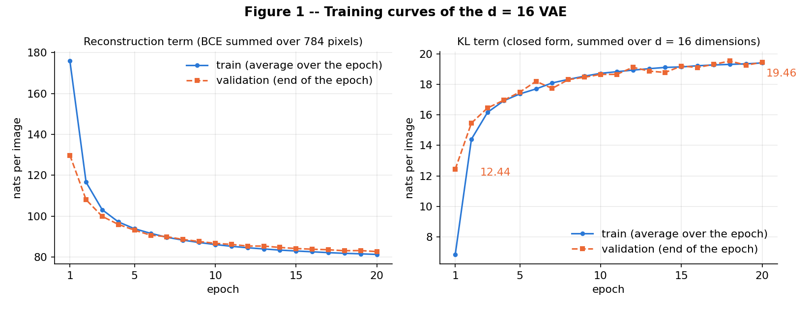
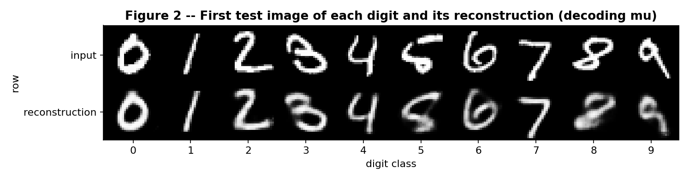
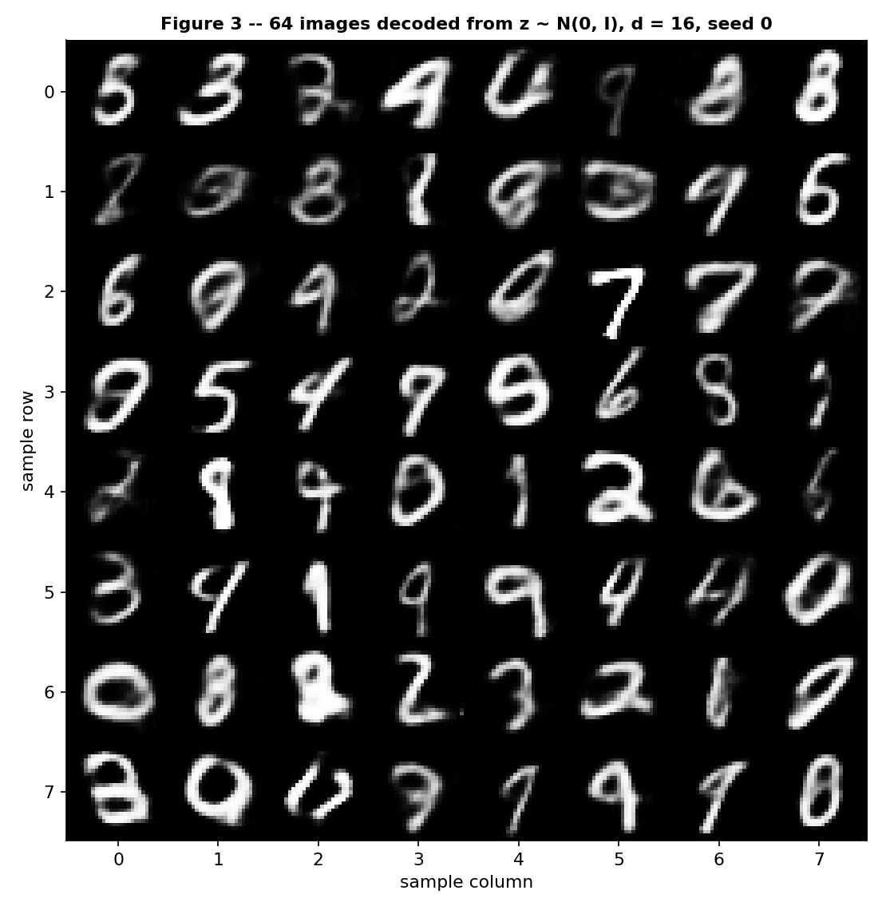
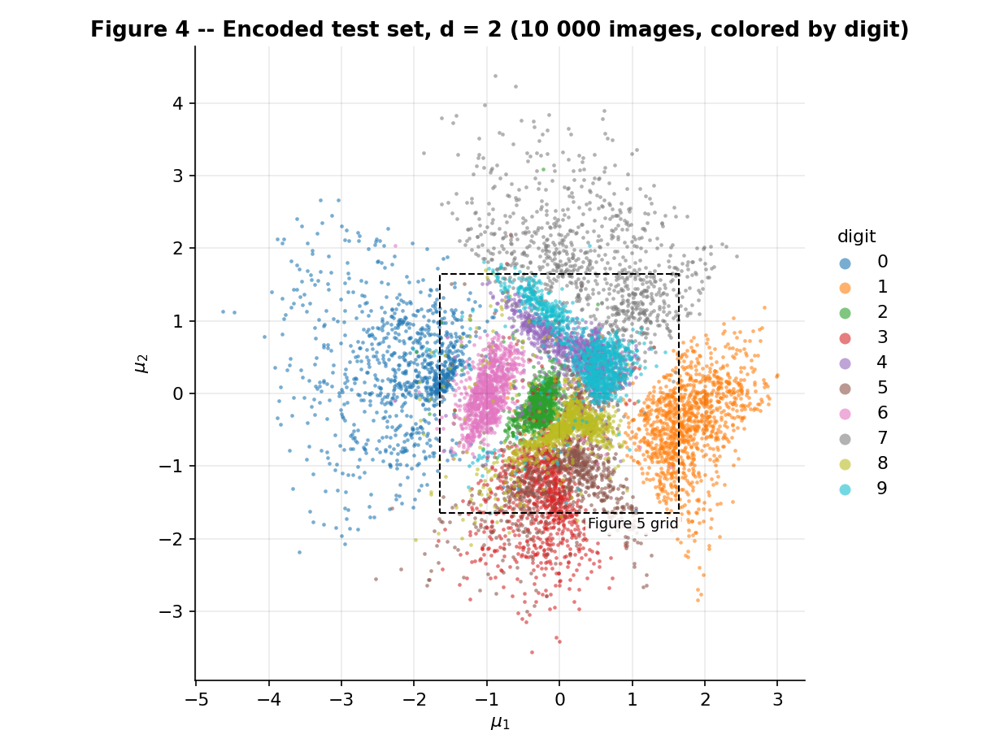
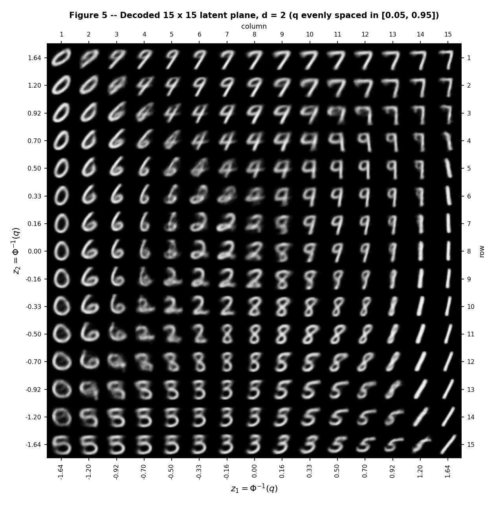
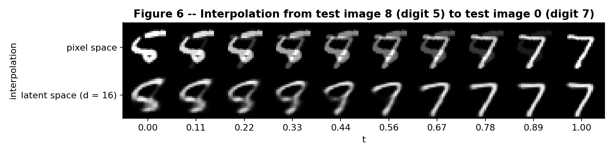

A VAE pays for two things at once: reconstructing its input, and keeping its latent codes close to a prior one can sample from. This report follows that tug of war. Exercise 1 trains a real VAE on MNIST (latent dimension \(d = 16\)) and logs the two terms of the loss separately; Exercise 2 repeats the experiment with \(d = 2\), a latent space that can be drawn, to see what the prior buys and what it costs.

Everything VAE-specific is written by hand in `code/vae.py`: the reparameterisation, both terms of the loss and the sampling. PyTorch supplies autograd, `nn.Linear` and Adam; torchvision only loads MNIST; scikit-learn appears for a 15-nearest-neighbour probe and a confusion matrix, scipy for `norm.ppf`. Every loss value is in nats per image (summed over the 784 pixels or over the latent dimensions, averaged over the images). Seeds: `torch.manual_seed(42)` right before each model is built, the split generator seeded with 42, and `torch.manual_seed(0)` right before the prior samples of Figure 3. The test set is used only for the final numbers of each model, for the figures the statement defines on test images, and for the post-hoc analysis numbers of 2E (per-digit reconstruction, the 15-nearest-neighbour probe, the digit centroids, the random-pair distances), none of which feeds back into training or model choice.

```bash
python docs/exercises/vae/code/vae.py                 # self-check of the hand-written loss terms
python docs/exercises/vae/code/ex1_vae_mnist.py       # Exercise 1: Figures 1-3, results_ex1.json (about 1 minute on a CPU)
python docs/exercises/vae/code/ex2_latent_plane.py    # Exercise 2: Figures 4-6, results_ex2.json (about 1 minute)
```

MNIST is downloaded to `code/data/` on the first run (not committed). Exercise 2 reads the \(d = 16\) checkpoint that Exercise 1 saves there, and runs Exercise 1 first if it is missing. Every number below is copied from `code/results_ex1.json` or `code/results_ex2.json`, which the two scripts write. Run on a clean copy of the `code/` folder (no `data/`, no results), `ex2_latent_plane.py` alone reproduced both JSON files and all six figures byte for byte (same machine, 4 CPU threads; another CPU or thread count can move the last digits).

## Exercise 1

*A VAE on MNIST.*

### A — Load and split the data

MNIST from torchvision with `transforms.ToTensor()` (pixels in \([0, 1]\)), each image flattened into a 784-vector. The 60 000 training images are split with the statement's call, unchanged except that the download folder `"data"` is `str(DATA_DIR)`:

```python
train_full = datasets.MNIST(str(DATA_DIR), train=True, download=True, transform=transforms.ToTensor())
test = datasets.MNIST(str(DATA_DIR), train=False, download=True, transform=transforms.ToTensor())
train, val = random_split(train_full, [50_000, 10_000],
                          generator=torch.Generator().manual_seed(42))
```

That gives **50 000** training images and **10 000** validation images; the **10 000** official test images are the test set. The MNIST folder is `code/data/`, resolved from `__file__` so the scripts run from any directory. `ToTensor()` is just `uint8 / 255`, so `load_data()` reads the same numbers straight from the dataset tensors (it asserts equality with the transform's output on the first image) instead of decoding 70 000 PIL images one by one.

`train_vae()` receives only `X_train` and `X_val`. The test tensors are loaded with the rest but first used after training, for the final numbers and for the figures the statement defines on test images; no decision during training looks at them.

### B — Build the model

| Part | Layers |
|---|---|
| Encoder | \(784 \to 512 \to 256\), ReLU after each |
| Heads | two linear layers \(256 \to d\): one for \(\boldsymbol{\mu}\), one for \(\log \boldsymbol{\sigma}^2\) |
| Decoder | \(d \to 256 \to 512 \to 784\), ReLU after the hidden layers, sigmoid at the output |

With \(d = 16\) the model has **1 079 600** parameters (asserted by `selfcheck()`). The loss per image, summed over pixels and over latent dimensions, with \(\beta = 1\), averaged over the images of the batch:

\[ L = \underbrace{-\sum_{j=1}^{784} \Big[x_j \log \hat{x}_j + (1 - x_j) \log (1 - \hat{x}_j)\Big]}_{\text{reconstruction (BCE)}} + \beta \cdot \underbrace{\tfrac{1}{2}\sum_{i=1}^{d} \left(\mu_i^2 + \sigma_i^2 - 1 - \log \sigma_i^2\right)}_{\text{KL}} \]

- **The head outputs \(\log \sigma^2\), not \(\sigma\).** A linear layer returns any real number; \(\sigma = \exp(\tfrac{1}{2}\log\sigma^2)\) is positive by construction, with no clamp or softplus, and \(\log\sigma^2\) is what the KL formula contains.
- **Reparameterisation.** \(z = \mu + \sigma \odot \varepsilon\) with \(\varepsilon \sim \mathcal{N}(0, I)\), written as `mu + torch.exp(0.5 * logvar) * torch.randn_like(mu)`. The noise is an input, not a function of the parameters, so autograd carries the gradient of the reconstruction through \(z\) into both heads.
- **KL in closed form.** For \(q(z \mid x) = \mathcal{N}(\mu, \operatorname{diag}\sigma^2)\) against the prior \(\mathcal{N}(0, I)\) the KL is the sum over the dimensions of \(\tfrac{1}{2}(\mu_i^2 + \sigma_i^2 - 1 - \log\sigma_i^2)\), written out in `kl_term()`. It is zero exactly when \(\mu = 0\) and \(\sigma = 1\).
- **BCE here, squared error in the lecture.** Both are \(-\log p(x \mid z)\) under a pixel likelihood: a Gaussian gives the squared error, a Bernoulli gives the BCE. The sigmoid output is a probability per pixel and MNIST pixels are nearly 0 or 1, so the Bernoulli fits.
- **`F.binary_cross_entropy(..., reduction="sum")` divided by the batch size, never `"mean"`.** This is the form the statement prescribes for the reconstruction term. `mean` would also divide by the 784 pixels and shrink the reconstruction 784-fold against the KL: a silent \(\beta \approx 784\), which pushes \(q(z \mid x)\) onto the prior and collapses the code. The per-image sum also keeps the units (nats per image) the statement's reference values are in.
- **Checked, not assumed.** `python vae.py` asserts that the KL is 0 at \(\mu = 0, \sigma = 1\), 0.5 at \(\mu = 1, \sigma = 1\) and equal to the closed-form value at \(\sigma = 2\); that `recon_term` equals the explicit \(-\sum_j [x_j \log p_j + (1 - x_j)\log(1 - p_j)] / B\); that gradients reach both heads through the reparameterisation; and the parameter count. No distribution objects and no library VAE class are used: both terms are plain tensor arithmetic.

```python
--8<-- "docs/exercises/vae/code/vae.py"
```

### C — Train

Adam, learning rate \(10^{-3}\), batch size 128, 20 epochs. `torch.manual_seed(42)` is called inside `train_vae()` immediately before `VAE(d)`, so it applies to every model; the training set is reshuffled every epoch with `torch.randperm`. Since 50 000 = 390 × 128 + 80, the last minibatch has 80 images and the running sums are weighted by the batch size, not by 128. For each epoch the function stores the two terms separately, on the training set (the average of the minibatch values over the epoch, while the weights are changing) and on the validation set (one pass in `eval()` mode with one sampled \(z\) per image, at the end of the epoch). All 20 epochs are in `results_ex1.json`; seven of them, in nats per image:

| epoch | train reconstruction | train KL | validation reconstruction | validation KL |
|--:|--:|--:|--:|--:|
| 1 | 175.89 | 6.83 | 129.78 | 12.44 |
| 2 | 116.60 | 14.41 | 108.01 | 15.47 |
| 3 | 103.10 | 16.17 | 99.85 | 16.46 |
| 5 | 93.81 | 17.39 | 93.10 | 17.51 |
| 10 | 86.07 | 18.74 | 86.66 | 18.67 |
| 15 | 82.92 | 19.16 | 84.12 | 19.22 |
| 20 | 81.23 | 19.42 | 82.62 | 19.46 |

The validation KL is **12.44 nats** at the first epoch and **19.46 nats** at the last. The test set, evaluated once after the last epoch (again one sampled \(z\) per image):

**reconstruction 81.97 nats + KL 19.49 nats = negative ELBO 101.46 nats per image.**

The statement says a correct implementation lands around 81 nats of reconstruction and 20 nats of KL; this run gives 81.97 and 19.49. The test numbers sit next to the validation ones at epoch 20 (82.62 + 19.46 = 102.07; totals are computed from the unrounded terms): the test reconstruction is 0.65 nats lower, the KL differs by 0.03.



Reading Figure 1. *Reconstruction (left):* both curves fall steeply during the first three epochs (train 175.89 → 103.10, validation 129.78 → 99.85) and flatten afterwards. At epoch 20 the training value is 81.23 and the validation value 82.62, a gap of 1.39 nats, and the validation total decreases at every epoch, so there is no sign of overfitting. *KL (right):* both curves rise over the first epochs (validation 12.44 → 16.46 by epoch 3) and flatten after about epoch 10; the two curves overlap (19.42 and 19.46 at epoch 20). The validation KL is not strictly monotone: it peaks at 19.54 in epoch 18 and has small dips, such as 18.21 → 17.75 at epoch 7. Epoch 1 looks odd for a measurement reason, not a bug: the training curve is an average over the whole epoch, which starts from an untrained network (544.70 + 0.03 nats on the validation set), while the validation point is measured at the end of the epoch. That is why the epoch-1 training reconstruction (175.89) is above the validation one (129.78) and the training KL (6.83) below the validation KL (12.44).

### D — Reconstructions and samples

**Figure 2.** The top row is the first test image of each digit 0–9 (test indices 3, 2, 1, 18, 4, 8, 11, 0, 61, 7); the bottom row is `model.decode(mu)` for the same images, where `mu` is the encoder's mean: no \(z\) is sampled. Most digits keep their class, slant and thickness, and the strokes come back softer than they went in; the 5, the 8 and the 9 blur most (the 8 turns into a smudge, the 9 loses its tail, the 5 its sharp corners).



**Figure 3.** `torch.manual_seed(0)` is followed immediately by `z = torch.randn(64, 16)` (nothing else draws random numbers in between); the 64 codes are decoded and tiled \(8 \times 8\), rows and columns labelled 0–7.



Most of the samples are recognisable digits and all ten classes appear, but they are softer and more irregular than the reconstructions of Figure 2. By eye I count 6 of the 64 that are not a digit at all (row, column: (1, 0), (1, 1), (1, 5), (4, 0), (6, 2), (7, 2)) and about 9 more that can be read two ways. That is a visual count; another reader could differ by a few. Section 1E gives the two reasons.

```python
--8<-- "docs/exercises/vae/code/ex1_vae_mnist.py"
```

### E — Analysis

The numbers below come from `results_ex1.json`: the per-epoch history and `validation_diagnostics()`, which uses the validation set only, with its own fixed seeds, after the figures are made.

**(1) The KL rises during the first epochs while the total falls. Why would the optimizer pay more KL?** Because the loss is the *sum* of the two terms and the KL is the price of the information the code carries. At initialisation the encoder is almost the prior (untrained network on the validation set: KL 0.03, reconstruction 544.70), so \(z\) says nothing about \(x\), and a decoder that ignores \(z\) can at best output one constant image, the mean training image: **205.60 nats** of reconstruction at KL \(= 0\). The reconstruction can only fall below that if \(z\) tells the decoder something about the input, and information about \(x\) in the code is exactly what the KL measures: the average KL equals the mutual information between image and code plus the distance of the aggregate posterior to the prior, so it is at least that information, and the \(d = 16\) code carries at most 19.5 nats (28.1 bits). The optimiser therefore pays one more nat of KL whenever that buys more than one nat of reconstruction, and early on it buys far more. From epoch 1 to epoch 20 the validation KL rises by **7.02 nats** (12.44 → 19.46) while the validation reconstruction falls by **47.16 nats** (129.78 → 82.62): about 6.7 nats of reconstruction per nat of KL, and the total falls by 40.14 (142.21 → 102.07). The rise of the KL is the model starting to use its code, not a failure. The curve flattens as the exchange rate drops (7.2 nats of reconstruction per nat of KL between epochs 1 and 2, 5.1 between epochs 10 and 20), but it is still above 1 after 20 epochs, so training has not reached the point where one more nat of KL stops paying. The same trade-off decides which dimensions are used: 11 of the 16 latent dimensions carry between 0.95 and 2.53 nats each, and 5 stay at the prior (KL below 0.002 each), because for them the information would cost more than it buys.

**(2) Figure 3 looks worse than Figure 2. Two separate reasons.**

*Where the prior samples land (the encoder side).* The decoder was trained on codes drawn from the clouds \(q(z \mid x)\) of the training images, and the union of those clouds, the aggregate posterior, does not fill the prior \(\mathcal{N}(0, I)\). Each cloud is small (mean \(\sigma = 0.20\) over the 11 active dimensions, against 1 for the prior) and the model only pays 19.5 nats of KL, so there are gaps between the clouds; a prior sample that lands in a gap is an input the decoder never saw, and it returns a hybrid or a non-digit. Measured on the validation set (distance, in the active dimensions, from a code to the nearest encoded training mean): the median is 1.16 for codes drawn from the encoder itself and 1.49 for prior samples, and **32.3 %** of the prior samples are farther than the 95th percentile of the encoder's own codes (1.64), where 5 % would be expected if the aggregate posterior matched the prior. This fits what Figure 3 shows: 6 non-digits and about 9 ambiguous images in my visual count.

*What the decoder outputs for a given \(z\) (the decoder side, independent of the first reason).* The decoder returns the Bernoulli mean \(E[x \mid z]\), a probability for every pixel, not a sample from it. Different images have overlapping posteriors around the same \(z\), and the BCE-optimal output for them is their average: gray strokes and soft edges. This holds even for the best possible code (the reconstructions of Figure 2 are already soft), so it is not a bug, and it would be there even if every prior sample landed on a well-trained code. Measured as the summed pixel entropy of the output (validation set, nats per image): real images 45.66 (this is also the floor of the BCE, \(\mathrm{BCE}(x, x)\)), reconstructions \(\mathrm{decode}(\mu)\) 81.15, prior samples 91.45. The share of gray pixels (\(0.1 < p < 0.9\)) is 8.6 %, 14.9 % and 17.0 %. The jump from data to reconstructions (+35.50 nats) is mostly the second reason, since \(\mu\) is the best code the model has for those images; the further +10.30 from reconstructions to prior samples is where the first reason adds on top.

**(3) Why decode \(\boldsymbol{\mu}\) and not a sampled \(z\) in Figure 2?** Figure 2 asks what the model can reconstruct. \(\mu\) is the centre of \(q(z \mid x)\) (its mean and its mode): one deterministic code per image, the same on every run. A sampled \(z = \mu + \sigma \odot \varepsilon\) adds noise that carries no information about the image (the KL term is what pays for allowing it) and draws a different picture each time, so a sampled row would mix the quality of the model with the luck of \(\varepsilon\). It also costs quality: on the validation set the BCE of \(\mathrm{decode}(\mu)\) is **77.54** nats against **82.64** with one sampled \(z\) per image, so sampling adds 5.10 nats (6.6 %) at the typical perturbation \(\sigma = 0.20\) per active dimension. The loss and ELBO numbers of 1C still use a sampled \(z\), because the ELBO is an expectation under \(q(z \mid x)\); reporting the \(\mathrm{decode}(\mu)\) value as the reconstruction term would give about 77.5 instead of about 82 and flatter the model.

## Exercise 2

*A latent space you can see.*

### A — Train a 2-D VAE

The same `train_vae()` call with `d = 2`: same data and split, `torch.manual_seed(42)` right before the model is built, \(\beta = 1\), Adam with learning rate \(10^{-3}\), batch size 128, 20 epochs. Only \(d\) changes (the two heads and the first decoder layer shrink: 1 068 820 parameters instead of 1 079 600). Test set, one sampled \(z\) per image, nats per image; the \(d = 16\) row is read from `results_ex1.json`, so both rows come from the same evaluation.

| | reconstruction | KL | negative ELBO |
|---|--:|--:|--:|
| \(d = 16\) (Exercise 1) | 81.97 | 19.49 | 101.46 |
| \(d = 2\) | 135.12 | 6.57 | 141.69 |
| difference (\(d = 2\) minus \(d = 16\)) | +53.16 | −12.93 | +40.23 |

The 2-D model reaches a test reconstruction of **135.12 nats** and a test KL of **6.57 nats** (negative ELBO 141.69), as the statement expects (roughly 135 and 7). Compared with \(d = 16\) it pays 12.93 nats less KL and 53.16 nats more reconstruction error. Its validation KL is 5.09 at the first epoch and 6.56 at the last.

### B — The encoded test set



Figure 4 shows **10 000** points: every test image (the script asserts it), at its encoder mean \(\mu\), no sampling, one colour per digit, with the ten digits in the legend. The dashed square is the region decoded in Figure 5. The classes fan out around the origin: 0 far to the left, 1 to the right, 7 on top, 3 at the bottom, 6, 2, 8 and 5 packed in the centre, and 4 and 9 lying on top of each other right of the centre. The codes use the plane the way the prior wants, at the prior's scale (variance of \(\mu\) 1.19 and 1.01 along the two axes), while each individual posterior is tiny (mean \(\sigma\) 0.045 and 0.047).

### C — The decoded plane

I decode a \(15 \times 15\) grid with \(z = \Phi^{-1}(q)\), \(q\) running over 15 evenly spaced values in \([0.05, 0.95]\) (`scipy.stats.norm.ppf`), which gives \(z \in \{-1.645, -1.204, -0.921, -0.697, -0.504, -0.328, -0.162, 0, 0.162, 0.328, 0.504, 0.697, 0.921, 1.204, 1.645\}\) on both axes. The 225 codes are \([z_1, z_2]\); the layout is Figure 4's: \(z_1\) increases from left to right and \(z_2\) from bottom to top (the first printed row is the largest \(z_2\)), and every image is drawn on the same gray scale \([0, 1]\).

**Why this spacing gives every cell the same prior mass:** \(\Phi\) is the CDF of the prior along each axis, so evenly spaced \(q\) means evenly spaced cumulative probability, and each of the 14 gaps between neighbouring grid values holds the same \(\mathcal{N}(0, 1)\) mass \(\Delta q = 0.9 / 14 = 0.0643\); the two coordinates being independent, every grid rectangle holds \(\Delta q^2 = 0.0041\) of the prior (the inner \(14 \times 14\) block holds \(0.9^2 = 0.81\)), where a linear grid would spend most of its cells in the thin tails.



Figure 5 has Figure 4's layout: 0 on the left, 1 on the right, 7 at the top right, 3 and 5 at the bottom, 6 left of the centre. The grid covers the central 90 % of the prior along each axis, so the far tails of the 0, 3 and 7 clouds (beyond \(\pm 1.645\)) are outside it. Section 2E reads it in detail.

### D — Interpolation

The two test images are test image **8** (a **5**) and test image **0** (a **7**). I did not pick them by eye: among the 45 pairs of different digits that can be formed from the ten images of Figure 2, they are the pair with the largest gap, in the committed run, between the pixel row and the latent row in their distance to real digits, where "distance to real digits" is the L2 distance, in pixel space, from an image to the closest of the 10 000 validation images, averaged over the 8 interior images (\(0 < t < 1\)). That is the most favourable pair for the latent row, so 2E also reports the average over all 45 pairs. The pair is fixed in the script (`IA, IB = 8, 0`); the computation over the 45 pairs is only printed and saved in `results_ex2.json` as a diagnostic, because its argmax moves with float rounding (see the note on reproducibility at the top: REPLACE_PAIR_8T).

Figure 6 uses \(t\) = `torch.linspace(0, 1, 10)`, ten columns including both ends. Top row, in pixel space: \((1 - t)\,\mathbf{x}_a + t\,\mathbf{x}_b\) on the original test images. Bottom row, in latent space, with the \(d = 16\) model of Exercise 1 (the checkpoint it saves): `decode((1 - t) * mu_a + t * mu_b)`, with the encoder means \(\mu_a, \mu_b\) of the two images. The end images of the bottom row are therefore reconstructions of \(\mathbf{x}_a\) and \(\mathbf{x}_b\), not the originals (compare with Figure 2).



```python
--8<-- "docs/exercises/vae/code/ex2_latent_plane.py"
```

### E — Analysis

**(1) Which digits overlap in Figure 4? The same transition in Figure 5.** The strongest overlap is **4 with 9**: the purple and cyan clouds lie on top of each other right of the centre, and their centroids are only 0.10 apart ((0.18, 0.59) and (0.28, 0.56); the prior has \(\sigma = 1\)). To measure it rather than judge by eye, I fitted a 15-nearest-neighbour vote on the 2-D codes of the training images and applied it to the test codes. It labels **27.6 %** of the test 4s as 9 and **31.3 %** of the test 9s as 4: 587 test images in the two directions. Then come 3 with 5 (9.1 % of the 3s labelled 5, 28.7 % of the 5s labelled 3; 348 images), 3 with 8 (180), 5 with 8 (155) and 7 with 9 (121). The 0s (far left) and the 1s (right) are almost isolated (vote recall 97.3 % and 97.7 %), while 5, 9 and 4 are the worst recognised (55.9 %, 60.9 % and 67.6 %). Over all digits the vote is right for 80.38 % of the test images, against 96.02 % with the \(d = 16\) codes.

In Figure 5 (rows and columns counted from 1 at the top-left) the same transitions are:

- *4 and 9.* The 4s, with an open top, form a diagonal band from (3, 5) down to (5, 9) and the 9s, with a closed loop, lie to its right and above it (columns 10–12 of rows 4–8). The midpoint of the two centroids falls at row 5, column 9, the last 4-like cell before the first 9 of that row. Cell (4, 9) is a blurry hybrid, a 4 whose top bar has closed into a flat-topped loop, between the 4 at (4, 8) and the 9 at (4, 10). Around rows 6–7, columns 5–9, the cells are blotchy smudges where 6, 2, 4, 8 and 9 meet and none of them is readable.
- *3, 5 and 8.* At the bottom, rows 13–15, a narrow band of 3s (columns 6–8 in rows 13–14, widening to columns 7–10 in row 15) sits between 5s on both sides. The 3–5 midpoint is (14, 7), inside the band, and the cells at its edges, (14, 6) and (14, 8), are 5/3 hybrids. The 8s lie directly above the 3s (rows 11–12); the 3–8 midpoint is (13, 7), a 3, and (13, 4) to (13, 6) are 8/3 hybrids, an 8 whose upper loop weakens as it turns into that 3. The 5–8 midpoint is (12, 8), an 8 whose upper right is opening into the 5 at (12, 9).
- *7 and 9.* At the top, the midpoint is (2, 10), a 7. In row 2 the 9 at (2, 8) becomes a 9 with an opening loop at (2, 9) and a 7 at (2, 10): the loop dissolves into the 7's top bar.

Most of these changes are gradual, a stroke closing or a loop opening, with a blurry hybrid in between and no third shape. Not all of them: from the 4 at (3, 6) to the 9 at (3, 7), and from the 3 at (13, 7) to the 5 at (13, 8), the shape switches within one grid step with no hybrid between.

**(2) \(d = 2\) reconstructs clearly worse than \(d = 16\). What do two numbers per image force the model to throw away?** Nearly everything except the class and a coarse style. The cost is test reconstruction 135.12 against 81.97 (+53.16 nats, +65 %), KL 6.57 against 19.49 (−12.93) and negative ELBO 141.69 against 101.46 (+40.23). In bits, the code carries at most 9.5 bits (the KL upper-bounds the information the code holds about the image) against 28.1 for \(d = 16\), and merely naming one of ten digits takes \(\log_2 10 = 3.3\) bits. Even a code that named the digit perfectly would keep at most 6.2 bits (4.26 nats) for everything else, and this one does not name it reliably (15-NN accuracy 80.38 % against 96.02 %): the classes must share the plane and overlap (Figure 4). It is a capacity limit, not noise: both dimensions are used (variance of \(\mu\) 1.19 and 1.01) and the posteriors are narrow (mean \(\sigma\) 0.045 and 0.047, against 0.20 over the active dimensions of \(d = 16\)).

Figure 5 shows what is lost. All 225 decoded images are smooth, blurry prototypes of their digit with a similar medium stroke thickness and no writer-specific detail (no hooks, crossbars or loop variants), and inside a digit's region the picture changes along one or two smooth directions only. The 1s along the right edge, for example, differ only in slant: they lean left in rows 5–6, stand upright in rows 7–8 and lean further and further right from row 9 down to row 15. The penalty also follows how much the digit varies, in test reconstruction nats for \(d = 16 \to d = 2\): digit 1, almost a one-parameter family, goes from 39.5 to 51.8 (+12.3, the smallest), while 2 (97.9 → 169.6, +71.7, the largest), 3 (+65.6) and 5 (+63.7), whose shapes vary most, pay the most.

**(3) Compare the two rows of Figure 6. Which one passes through images that look like digits, and why does the other one not?** The latent row does; the pixel row does not. The pixel row is a cross-fade: at \(t = 0.44\) and \(0.56\) the 5 and the 7 are both on the image at about half intensity, the 5's bowl and the 7's stem drawn on top of each other, so no image between the two ends is a digit. Every image of the latent row is one connected glyph: for \(t = 0\) to \(0.22\) a blurry 5/8-like shape (the reconstruction of the 5, not the 5 itself), at \(t = 0.33\) and \(0.44\) a 9-like loop on a stem, at \(t = 0.56\) a 7 with a faint remnant of that loop, and from \(t = 0.67\) a clean 7.

The reason is geometry. Digit images lie on a thin, curved set inside the 784-dimensional pixel space, and the pixel average of two points of such a set is generally off it: a superposition of two digits is not a digit. The latent space is different on both ends: the KL term keeps the clouds of different images overlapping and centred on the origin, so the straight segment from \(\mu_a\) to \(\mu_b\) mostly runs through regions where the decoder has seen data, and the nonlinear decoder maps that straight segment onto a curve along the image set. In numbers (L2 distance from the 8 interior images to the closest of the 10 000 validation images, averaged): 5.42 for the pixel row against 4.07 for the latent row for this pair, and the latent row is the closer one for all 45 pairs of Figure 2's images (mean difference 0.75, from 0.02 to 1.35; this pair has the largest). For scale, a real test digit is 4.72 from its closest validation digit, and for 500 random pairs of different digits the \(t = 0.5\) image is 5.47 away in pixel space and 4.52 in latent space. The caveat is that L2 rewards blur (a blurry image is close to many digits), so these numbers understate the visual gap; the pictures are the stronger evidence.

## Results summary

| # | Quantity | Value |
|---|---|---|
| 1 | Ex. 1 — test reconstruction, KL and negative ELBO (\(d = 16\)) | 81.97 + 19.49 = 101.46 nats per image |
| 2 | Ex. 1 — validation KL at the first and at the last epoch | 12.44 nats (epoch 1) and 19.46 nats (epoch 20) |
| 3 | Ex. 2 — test reconstruction and KL (\(d = 2\)) | 135.12 and 6.57 nats per image |
| 4 | Ex. 2 — the two test indices interpolated | test indices 8 (digit 5) and 0 (digit 7) |
