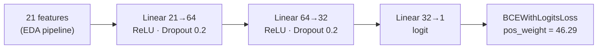
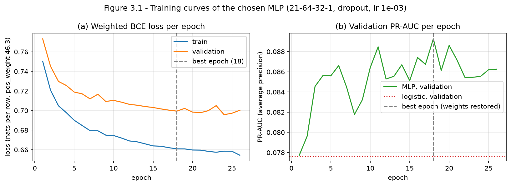
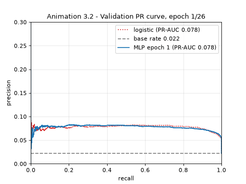
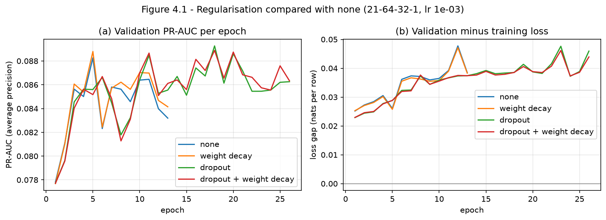
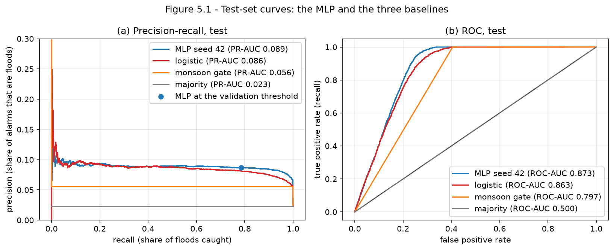
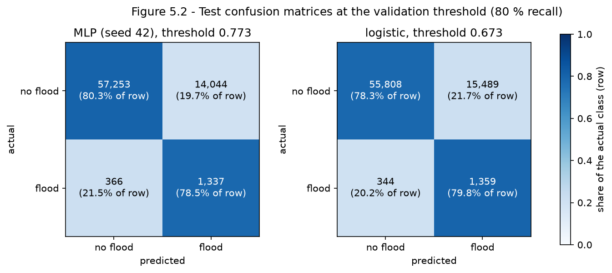
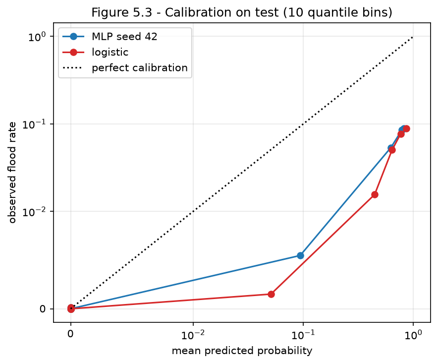
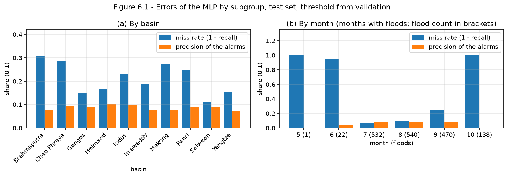
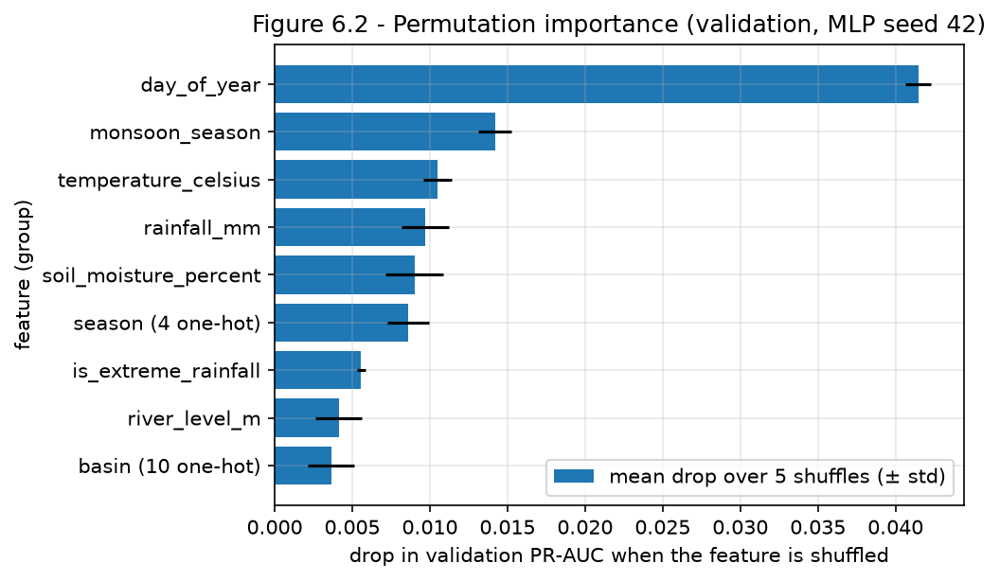

# 2. Classification — Will this station flood tomorrow?

**Project:** ASIA-FLOOD 25-Year Flood Risk Atlas · **Task:** binary classification ·
**Target:** `flood_event_occurred` on day *t+1*, for the same station

**Team:** Luigi Lopes · Lucas Abatepietro · Marcelo Alonso

The second delivery trains a neural network on the dataset of the [EDA](../eda/index.md). It
answers two questions. Does the network learn something that simpler models do not? And how
far can the number it reports be trusted?

**Short answer.** The MLP beats every baseline on the test set, in PR-AUC and in ROC-AUC. Its
gain over logistic regression is real: about 3 times the variation between seeds. But the gain
is small: **+4.27 %** in PR-AUC, against the **+10 %** we set as the success criterion before
training. With only the measurements of the day itself, both models stop at a precision of
about 8–9 % when they catch 80 % of the floods.

!!! warning "Synthetic data"
    The dataset is generated, not observed (see the [EDA](../eda/index.md)). The methods are
    real; the numbers describe a simulator, not flood risk in Asia.

**Code.** All code for this delivery is in [`code/`](https://github.com/luigilopesz/Neural-Networks-Deep-Learning/tree/main/docs/projects/classification/code):

| file | role | reads the test set? |
|---|---|:--:|
| [`common.py`](https://github.com/luigilopesz/Neural-Networks-Deep-Learning/blob/main/docs/projects/classification/code/common.py) | imports the EDA's `data.py` and `pipeline.py`; metrics, the threshold rule, figure helper | — |
| [`model.py`](https://github.com/luigilopesz/Neural-Networks-Deep-Learning/blob/main/docs/projects/classification/code/model.py) | the network (PyTorch) and the training loop with early stopping | — |
| [`select_on_val.py`](https://github.com/luigilopesz/Neural-Networks-Deep-Learning/blob/main/docs/projects/classification/code/select_on_val.py) | steps 0–4: baselines, search and every choice, on validation | **no** |
| [`test_once.py`](https://github.com/luigilopesz/Neural-Networks-Deep-Learning/blob/main/docs/projects/classification/code/test_once.py) | steps 5–6: one evaluation on test, error analysis | **yes, once** |

## 0. Starting point

**Pipeline.** `common.load_splits()` imports `data.py` and `pipeline.py` from `eda/code/`
unchanged. The `ColumnTransformer` is fitted on the **310,500 training rows (2000–2016)**
only. Validation (2017–2020, **73,050** rows) and test (2021–2024, **73,000** rows) are only
transformed. The result is the EDA's 21 features: 7 numeric, `basin` one-hot (10) and
`season` one-hot (4). The leaky columns `flood_risk_score` and `severity_level` never enter.

**Split.** The split is the EDA's chronological split, with seed 42. Validation is the last
four years before the test window, so it never overlaps the test set. A random split would put
near-copies of training days in the test set (EDA, Figure 1.5).

| split | years | rows | floods | rate | base rate inside the monsoon |
|---|---|---:|---:|---:|---:|
| train | 2000–2016 | 310,500 | 6,566 | 2.1147 % | — |
| validation | 2017–2020 | 73,050 | 1,620 | 2.2177 % | 5.2941 % (30,600 monsoon rows) |
| test | 2021–2024 | 73,000 | 1,703 | 2.3329 % | 5.5621 % |

**Fixed before any training** (and printed by `select_on_val.py` before the first model is fitted):

- **Main metric: PR-AUC** (average precision). The task is 45 : 1 imbalanced, so accuracy is
  useless: "never flood" scores 97.78 % on validation. ROC-AUC and PR-AUC inside the monsoon
  are reported next to it.
- **Operating threshold:** the highest threshold whose **validation** recall is still ≥ 80 %.
  Missing a flood (no warning, no evacuation) costs far more than a false alarm, so recall is
  fixed first. The report then states the precision that recall costs.
- **Success criterion:** *the MLP's test PR-AUC (mean of 3 seeds) is at least 10 % higher
  (relative) than the logistic regression's test PR-AUC.*

## 1. Baselines

Three baselines are fitted on the same 21 pipeline features and scored on validation.

| baseline (validation) | PR-AUC | ROC-AUC | threshold | precision | recall | accuracy |
|---|---:|---:|---:|---:|---:|---:|
| majority class (`DummyClassifier("most_frequent")`) | 0.0222 | 0.5000 | 0.5 | 0.0000 | 0.0000 | **0.9778** |
| monsoon gate ("flood whenever `monsoon_season = 1`") | 0.0529 | 0.7971 | 1.0 | 0.0529 | 1.0000 | 0.6033 |
| logistic regression (`class_weight="balanced"`) | **0.0776** | **0.8630** | 0.6734 | 0.0789 | 0.8000 | 0.7884 |

**Reading.**

- **Majority class.** It is the accuracy trap: 97.78 % accuracy, zero floods caught, and a
  PR-AUC equal to the base rate (0.0222).
- **Monsoon gate.** It is the free calendar rule from the EDA (F3). It catches every flood
  but is right only 5.29 % of the time, which is exactly the monsoon base rate.
- **Logistic regression.** It is the real reference. It lifts PR-AUC from 0.0529 (gate) to
  0.0776. But at 80 % recall its precision is only 7.89 %, against the gate's 5.29 %.

**Code:** [`select_on_val.py`](https://github.com/luigilopesz/Neural-Networks-Deep-Learning/blob/main/docs/projects/classification/code/select_on_val.py)

## 2. The network



| choice | value | why |
|---|---|---|
| layers × units | 21 → **64 → 32** → 1 | Two hidden layers can model curved rules, such as a flood rate that peaks in mid-year (EDA F3), which a linear model cannot. The width halves at each layer, a small funnel. The search also tried one layer, 21 → 32 → 1. |
| activation | ReLU | No saturation, so gradients do not vanish; and it is cheap. |
| initialisation | He (Kaiming) normal for the ReLU layers, Xavier for the output, biases 0 | He keeps the activation variance stable through ReLU layers. |
| output | **1 unit, raw logit** | Binary task: one logit. The sigmoid lives inside the loss. |
| loss | `BCEWithLogitsLoss(pos_weight=46.29)` | Numerically stable binary cross-entropy. `pos_weight` = negatives / positives in **train** handles the imbalance in the loss, with no resampling. |
| parameters | **3,521** = 21·64+64 + 64·32+32 + 32+1 | **88.2 training rows per parameter**, so the network is far too small to memorise 310,500 rows. |

**Code:** [`model.py`](https://github.com/luigilopesz/Neural-Networks-Deep-Learning/blob/main/docs/projects/classification/code/model.py)
(`python model.py` checks the parameter count and that the same seed gives the same run).

## 3. Training

| choice | value | why |
|---|---|---|
| optimiser | **AdamW** | It adapts the step size per weight, which helps with the large gradients that `pos_weight` puts on the few flood rows. Its weight decay is decoupled, so the decay setting is exactly the regulariser compared in step 4. |
| learning rate | **1e-3** (3e-3 also tried) | 1e-3 is Adam's standard value. 3e-3 peaked by epoch 3–11 and lost in the search (step 4). |
| batch | **1,024** | That is about 21.7 floods per batch, so every step sees positives. It also gives 304 steps per epoch, which is fast on a CPU. |
| epochs | up to 60, **patience 8** on validation PR-AUC | Validation PR-AUC is noisy from one epoch to the next (0.0885 → 0.0853 between epochs 11 and 12, Figure 3.1b), so patience must span several epochs. |
| seed | 42 (initialisation, dropout masks, batch order) | One CPU thread and deterministic kernels: a re-run gives identical numbers. |

**Early stopping.** After every epoch the loop measures validation PR-AUC and keeps a copy of
the best weights. It stops after 8 epochs without improvement and restores the best weights.
The chosen network peaked at **epoch 18** and stopped at **epoch 26**.



**Figure 3.1.** **(a)** Weighted BCE per epoch, both measured with dropout off. **(b)**
Validation PR-AUC per epoch, with the logistic baseline (0.0776).

| epoch | train loss | validation loss | validation PR-AUC |
|---:|---:|---:|---:|
| 1 | 0.7504 | 0.7733 | 0.0777 |
| **18 (best, restored)** | 0.6609 | 0.6994 | **0.0893** |
| 26 (last) | 0.6544 | 0.7003 | 0.0863 |

**Reading.**

- **Convergence.** It converges: training loss falls every epoch, and validation loss falls
  until **epoch 24 (0.6958)**.
- **Overfitting.** There is no sharp onset of overfitting. The validation − training gap
  grows slowly, from **0.0229** at epoch 1 to **0.0459** at epoch 26. Validation loss stays
  flat after epoch 18 (0.6994 → 0.7003) while training loss keeps falling, which is where
  overfitting would begin.
- **Plateau.** From epoch 11 on, validation PR-AUC stays between **0.0851 and 0.0893**. The
  network stops improving because of what the 21 same-day features can say, not because it
  overfits. It is above the logistic baseline (0.0776) at every epoch, from epoch 1.

??? note "Every epoch of the chosen run (printed by `select_on_val.py`)"

    | epoch | train loss | val loss | val − train | val PR-AUC |
    |---:|---:|---:|---:|---:|
    | 1 | 0.7504 | 0.7733 | 0.0229 | 0.0777 |
    | 2 | 0.7207 | 0.7452 | 0.0244 | 0.0796 |
    | 3 | 0.7049 | 0.7298 | 0.0249 | 0.0846 |
    | 4 | 0.6978 | 0.7256 | 0.0278 | 0.0856 |
    | 5 | 0.6901 | 0.7189 | 0.0288 | 0.0856 |
    | 6 | 0.6848 | 0.7171 | 0.0323 | 0.0866 |
    | 7 | 0.6795 | 0.7120 | 0.0325 | 0.0845 |
    | 8 | 0.6794 | 0.7167 | 0.0373 | 0.0818 |
    | 9 | 0.6749 | 0.7093 | 0.0344 | 0.0832 |
    | 10 | 0.6745 | 0.7104 | 0.0359 | 0.0864 |
    | 11 | 0.6719 | 0.7086 | 0.0367 | 0.0885 |
    | 12 | 0.6690 | 0.7063 | 0.0373 | 0.0853 |
    | 13 | 0.6680 | 0.7054 | 0.0374 | 0.0856 |
    | 14 | 0.6660 | 0.7041 | 0.0381 | 0.0867 |
    | 15 | 0.6639 | 0.7031 | 0.0392 | 0.0851 |
    | 16 | 0.6636 | 0.7017 | 0.0381 | 0.0874 |
    | 17 | 0.6621 | 0.7004 | 0.0383 | 0.0867 |
    | **18** | **0.6609** | **0.6994** | **0.0385** | **0.0893** |
    | 19 | 0.6608 | 0.7022 | 0.0414 | 0.0861 |
    | 20 | 0.6597 | 0.6984 | 0.0387 | 0.0886 |
    | 21 | 0.6596 | 0.6978 | 0.0382 | 0.0872 |
    | 22 | 0.6583 | 0.6999 | 0.0416 | 0.0855 |
    | 23 | 0.6574 | 0.7051 | 0.0476 | 0.0855 |
    | 24 | 0.6586 | 0.6958 | 0.0372 | 0.0856 |
    | 25 | 0.6584 | 0.6973 | 0.0389 | 0.0862 |
    | 26 | 0.6544 | 0.7003 | 0.0459 | 0.0863 |



**Animation 3.2.** The validation precision-recall curve of the chosen network, one frame
per epoch (1–26), against the logistic curve and the base rate.
**Conclusion:** the network's gain is concentrated at high recall (right side), the region
where a warning system operates; at low recall both curves are equally noisy.

## 4. Regularisation and hyperparameters

**Search.** 16 configurations, every one trained with seed 42 and early stopping, then ranked
by validation PR-AUC:

- 4 regularisation settings: none, weight decay 1e-2 (AdamW), dropout 0.2, or both;
- × 2 architectures: 21-32-1 and 21-64-32-1;
- × 2 learning rates: 1e-3 and 3e-3.

The test set plays no part in it.

| # | regularisation | architecture | lr | params | best epoch | **val PR-AUC** | val − train loss |
|--:|---|---|---:|---:|---:|---:|---:|
| **1** | **dropout** | **21-64-32-1** | **1e-3** | 3,521 | 18 | **0.0893** | 0.0385 |
| 2 | dropout + weight decay | 21-64-32-1 | 1e-3 | 3,521 | 18 | 0.0889 | 0.0385 |
| 3 | dropout + weight decay | 21-64-32-1 | 3e-3 | 3,521 | 11 | 0.0888 | 0.0452 |
| 4 | weight decay | 21-64-32-1 | 1e-3 | 3,521 | 5 | 0.0888 | 0.0258 |
| 5 | none | 21-64-32-1 | 1e-3 | 3,521 | 5 | 0.0883 | 0.0261 |
| 6 | none | 21-64-32-1 | 3e-3 | 3,521 | 3 | 0.0880 | 0.0346 |
| 7 | dropout | 21-32-1 | 3e-3 | 737 | 25 | 0.0876 | 0.0369 |
| 8 | weight decay | 21-64-32-1 | 3e-3 | 3,521 | 3 | 0.0874 | 0.0330 |
| 9 | dropout + weight decay | 21-32-1 | 3e-3 | 737 | 17 | 0.0873 | 0.0376 |
| 10 | dropout | 21-32-1 | 1e-3 | 737 | 47 | 0.0869 | 0.0392 |
| 11 | weight decay | 21-32-1 | 3e-3 | 737 | 17 | 0.0864 | 0.0379 |
| 12 | dropout | 21-64-32-1 | 3e-3 | 3,521 | 3 | 0.0864 | 0.0315 |
| 13 | dropout + weight decay | 21-32-1 | 1e-3 | 737 | 47 | 0.0862 | 0.0384 |
| 14 | none | 21-32-1 | 1e-3 | 737 | 17 | 0.0855 | 0.0322 |
| 15 | weight decay | 21-32-1 | 1e-3 | 737 | 17 | 0.0855 | 0.0320 |
| 16 | none | 21-32-1 | 3e-3 | 737 | 3 | 0.0839 | 0.0270 |

**Regularisation compared with none.** The comparison holds the chosen architecture
(21-64-32-1) and learning rate (1e-3) fixed:

| technique | val PR-AUC | vs none | best epoch |
|---|---:|---:|---:|
| none | 0.0883 | — | 5 |
| weight decay 1e-2 | 0.0888 | +0.0005 | 5 |
| **dropout 0.2** | **0.0893** | **+0.0010** | 18 |
| dropout + weight decay | 0.0889 | +0.0006 | 18 |



**Figure 4.1.** **(a)** Validation PR-AUC per epoch for the four settings. **(b)** Validation
minus training loss per epoch.

**Reading.**

- **Architecture and learning rate.** The two-layer network takes the **top 6 places** and
  7 of the top 8. For the two-layer network, lr 1e-3 beats 3e-3 under all four
  regularisation settings; the faster rate stops improving early (best epoch 3 in three of
  the four). For the one-layer network, 3e-3 wins 3 of 4, because 1e-3 is slow for it (best
  epoch up to 47).
- **Dropout.** It does not lower the gap at equal epochs; the curves in Figure 4.1b nearly
  coincide. What it does is keep the noisy validation curve climbing longer, so the run
  stops later (epoch 18 against 5) at a slightly higher peak.
- **Weight decay.** It changes almost nothing at 1e-2.
- **Honest caveat.** All four differences (+0.0005 to +0.0010) are **smaller than the
  seed-to-seed standard deviation of validation PR-AUC, 0.0015** (step 5). With 88 rows per
  parameter, there is little overfitting for regularisation to remove. The choice of dropout
  is the rule ("best on validation") applied honestly, not evidence that dropout matters
  here.

**Chosen configuration:** 21-64-32-1, ReLU, dropout 0.2, no weight decay, AdamW lr 1e-3,
batch 1,024.

**The MLP on validation, before test.**

- PR-AUC **0.0893** (logistic 0.0776, **+15.03 %**), ROC-AUC 0.8761.
- The 80 %-recall threshold is **0.7731**.
- Precision at that threshold is **0.0837** (logistic: 0.0789).

**Code:** [`select_on_val.py`](https://github.com/luigilopesz/Neural-Networks-Deep-Learning/blob/main/docs/projects/classification/code/select_on_val.py)
(writes `results_select.json`, which freezes the configuration and the thresholds).

## 5. Test evaluation

`test_once.py` is the only script that loads 2021–2024, and nothing is chosen in it.

- **Seeds.** It retrains the frozen configuration with seeds **42, 43 and 44**. Each run uses
  early stopping on validation and the 80 %-recall threshold from validation.
- **Reproducibility check.** Seed 42 reproduces the selected model exactly (an `assert`
  checks it).
- **Baselines.** The baselines are refitted on train, with the logistic threshold also taken
  from validation.

The test set did not help choose anything. The script was run more than once while the
error-analysis printout and figure layout were being written, and every run produced
byte-identical results (`results_test.json`).

| model (test, threshold from validation) | PR-AUC | ROC-AUC | threshold | precision | recall | F1 (flood) | macro F1 | TP | FP | FN | TN |
|---|---:|---:|---:|---:|---:|---:|---:|---:|---:|---:|---:|
| majority class | 0.0233 | 0.5000 | 0.5 | 0.0000 | 0.0000 | 0.0000 | 0.4941 | 0 | 0 | 1,703 | 71,297 |
| monsoon gate | 0.0556 | 0.7970 | 1.0 | 0.0556 | 0.9994 | 0.1054 | 0.4256 | 1,702 | 28,898 | 1 | 42,399 |
| logistic regression | 0.0863 | 0.8629 | 0.6734 | 0.0807 | 0.7980 | 0.1465 | 0.5111 | 1,359 | 15,489 | 344 | 55,808 |
| **MLP, seed 42** | **0.0888** | **0.8731** | 0.7731 | **0.0869** | 0.7851 | **0.1565** | **0.5224** | 1,337 | 14,044 | 366 | 57,253 |
| **MLP, 3 seeds (mean ± std)** | **0.0900 ± 0.0012** | **0.8733 ± 0.0008** | — | 0.0860 ± 0.0009 | 0.7792 ± 0.0097 | 0.1549 ± 0.0017 | 0.5212 ± 0.0010 | | | | |

??? note "Per seed, and the per-class report"

    | seed | best epoch | val PR-AUC | test PR-AUC | test ROC-AUC | precision | recall | F1 |
    |---:|---:|---:|---:|---:|---:|---:|---:|
    | 42 | 18 | 0.0893 | 0.0888 | 0.8731 | 0.0869 | 0.7851 | 0.1565 |
    | 43 | — | — | 0.0899 | 0.8742 | 0.0859 | 0.7845 | 0.1549 |
    | 44 | — | — | 0.0912 | 0.8727 | 0.0851 | 0.7681 | 0.1532 |
    | mean ± std | 16.67 ± 1.15 | 0.0882 ± 0.0015 | 0.0900 ± 0.0012 | 0.8733 ± 0.0008 | 0.0860 ± 0.0009 | 0.7792 ± 0.0097 | 0.1549 ± 0.0017 |

    MLP seed 42 at threshold 0.7731, per class:

    | class | precision | recall | F1 | support |
    |---|---:|---:|---:|---:|
    | 0 — no flood | 0.9936 | 0.8030 | 0.8882 | 71,297 |
    | 1 — flood | 0.0869 | 0.7851 | 0.1565 | 1,703 |
    | macro | | | 0.5224 | accuracy 0.8026 |

    PR-AUC inside the monsoon equals the global PR-AUC to 4 decimals for every model but
    seeds 43/44 (0.0900, 0.0913), because the models rank the off-season days below
    the monsoon days. Seed 42 raises **0 alarms on the 42,400 off-season test rows**.

**Was the criterion met? No.**

- **The criterion.** The MLP's mean test PR-AUC is **0.0900** against **0.0863** for
  logistic regression: a ratio of **1.0427**, or **+4.27 %**. The criterion asked for
  ≥ 1.10.
- **Is the gap noise?** The gap (0.0037) is **3.0× the seed standard deviation (0.0012)**,
  and all three seeds beat the logistic regression. So the network does learn something the
  linear model does not; it is just small.
- **At the operating point.** At about 80 % recall the MLP's alarms are right 8.69 % of the
  time against 8.07 %. That means **10.50 false alarms per flood caught, against 11.40**
  for logistic regression (1,445 fewer false alarms over four years).
- **Validation was optimistic.** Validation promised +15.03 %; test delivered +4.27 %.
  Part of that is selection: the best of 16 configurations on validation is optimistic by
  construction. This is why the test set had to stay untouched.



**Figure 5.1.** Test precision-recall **(a)** and ROC **(b)** curves for the MLP (seed 42) and
the three baselines; the dot is the MLP at the validation threshold (recall 0.7851, precision
0.0869).
**Conclusion:** the MLP's curve lies on or above the logistic one almost everywhere and pulls
away above 80 % recall; both are far above the monsoon gate, so the models do add something
inside the monsoon.



**Figure 5.2.** Test confusion matrices at the validation threshold, counts and share of the
actual class.
**Conclusion:** at the same ~80 % recall, the MLP raises **14,044** false alarms against
**15,489** for logistic regression, while missing 22 more floods (366 vs 344).



**Figure 5.3.** Calibration on test, 10 quantile bins, symmetric-log axes.
**Conclusion:** the scores are **rankings, not probabilities**. `pos_weight` tells the loss
that floods are ~46× more common than they are. The mean predicted value is therefore
**0.2320** against a base rate of **0.0233**, and the top bin says 0.8143 where 0.0884 floods.
A recalibration on validation (Platt scaling) would fix this if probabilities were needed. The
threshold rule does not need it.

**Code:** [`test_once.py`](https://github.com/luigilopesz/Neural-Networks-Deep-Learning/blob/main/docs/projects/classification/code/test_once.py)

## 6. Error analysis

All on the test set, MLP seed 42, threshold 0.7731 from validation.



**Figure 6.1.** Miss rate (1 − recall) and precision of the alarms **(a)** by basin and **(b)**
by month (only months with floods; flood count in brackets).
**Conclusion:** the errors are a calendar effect, not a geography effect. Every basin misses
11–31 % of its floods, but the **October floods are missed 100 %** (138 of 138) and June
floods 95.45 % (22 floods), while July–August miss 6–10 %.

| pattern | numbers | hypothesis |
|---|---|---|
| **Edge-of-monsoon floods are missed** | October: miss rate **1.0000** (138 floods, 1 alarm); June 0.9545 (22). May, June and October hold **161 of the 1,703** test floods (9.45 %) but **160 of the 366 misses (43.72 %)**. | In training, **95.58 %** of floods fall in July–September and only **4.42 %** (290 of 6,566) in June or October. The network learned a mid-year bump on `day_of_year` (step-6 importance, below). The validation threshold reaches 80 % recall using July–September alone, so the edge months sit below it. The missed floods are not dry days: their mean rainfall today is **57.8 mm** against **38.3 mm** for the floods caught. The network lets the calendar outvote the rain. |
| **The one off-season flood** | The worst miss, p = 0.000: `ASIA_0016`, Indus, **2021-05-22**, rainfall 6.16 mm, soil moisture 24.87 %. | This is the single flood in 25 years outside the monsoon flag (EDA F3: the gate catches 9,888 of 9,889). It looks like a dry spring day. No model built on these features can catch it. |
| **Basins differ only mildly** | Miss rate from **0.1098** (Salween) to **0.3077** (Brahmaputra); precision 0.0722–0.1025; PR-AUC 0.0664 (Yangtze) to 0.1167 (Helmand). | Geography explains little, as the EDA found (F6: basin rates differ by 1.27×). With about 130–210 test floods per basin, differences of a few points are within sampling noise. |
| **Confident false alarms in early September, Salween** | The 5 worst false positives (p = 0.878–0.888) are all `ASIA_0033`–`0035`, Salween, 1–9 September, at **39–42 °C**, with moderate rain (30–31 mm) and a low river (5.1–6.1 m). | Peak-season date plus very high temperature, the 3rd most important feature, push the score up. Nothing in a single day says "the river is not rising"; a 7-day window of rain and river level would. |

??? note "Supporting tables (printed by `test_once.py`)"

    **By basin** (sorted by miss rate):

    | basin | rows | floods | miss rate | precision | alarms | PR-AUC |
    |---|---:|---:|---:|---:|---:|---:|
    | Brahmaputra | 7,300 | 156 | 0.3077 | 0.0754 | 1,433 | 0.0698 |
    | Chao Phraya | 7,300 | 208 | 0.2885 | 0.0952 | 1,554 | 0.1005 |
    | Mekong | 7,300 | 175 | 0.2743 | 0.0785 | 1,618 | 0.0824 |
    | Pearl | 7,300 | 185 | 0.2486 | 0.0907 | 1,532 | 0.1032 |
    | Indus | 7,300 | 168 | 0.2321 | 0.1000 | 1,290 | 0.0919 |
    | Irrawaddy | 7,300 | 159 | 0.1887 | 0.0787 | 1,639 | 0.0887 |
    | Helmand | 7,300 | 183 | 0.1694 | 0.1025 | 1,483 | 0.1167 |
    | Yangtze | 7,300 | 132 | 0.1515 | 0.0722 | 1,552 | 0.0664 |
    | Ganges | 7,300 | 173 | 0.1503 | 0.0905 | 1,625 | 0.0872 |
    | Salween | 7,300 | 164 | 0.1098 | 0.0882 | 1,655 | 0.1091 |

    **By month** (months with floods):

    | month | rows | floods | miss rate | precision | alarms | PR-AUC |
    |---:|---:|---:|---:|---:|---:|---:|
    | 5 | 6,200 | 1 | 1.0000 | — | 0 | 0.0004 |
    | 6 | 6,000 | 22 | 0.9545 | 0.0370 | 27 | 0.0628 |
    | 7 | 6,200 | 532 | 0.0639 | 0.0893 | 5,575 | 0.0942 |
    | 8 | 6,200 | 540 | 0.1000 | 0.0875 | 5,552 | 0.0891 |
    | 9 | 6,000 | 470 | 0.2511 | 0.0833 | 4,226 | 0.0893 |
    | 10 | 6,200 | 138 | 1.0000 | 0.0000 | 1 | 0.0495 |

    **Mean of today's measurements by outcome**, monsoon test rows:

    | outcome | rows | rainfall (mm) | river level (m) | soil moisture (%) | temperature (°C) | mean score |
    |---|---:|---:|---:|---:|---:|---:|
    | TP (flood, caught) | 1,337 | 38.343 | 8.349 | 57.764 | 34.933 | 0.800 |
    | FN (flood, missed) | 365 | 57.843 | 11.350 | 59.370 | 36.983 | 0.612 |
    | FP (false alarm) | 14,044 | 39.948 | 8.587 | 58.273 | 34.968 | 0.800 |
    | TN | 14,854 | 38.739 | 8.598 | 53.323 | 31.467 | 0.297 |

    True and false alarms have almost the same average day (38.3 vs 39.9 mm, 57.8 vs 58.3 %
    soil moisture): today's measurements alone cannot tell them apart, which is the precision
    ceiling seen in Figure 5.1.

    **5 worst false negatives** (floods, lowest score):

    | station | date | basin | rainfall | river | soil | temp. | score |
    |---|---|---|---:|---:|---:|---:|---:|
    | ASIA_0016 | 2021-05-22 | Indus | 6.16 | 6.23 | 24.87 | 14.27 | 0.000 |
    | ASIA_0012 | 2022-10-22 | Yangtze | 33.96 | 9.22 | 47.13 | 33.40 | 0.059 |
    | ASIA_0042 | 2024-10-24 | Helmand | 36.47 | 9.04 | 54.74 | 32.69 | 0.078 |
    | ASIA_0032 | 2024-10-23 | Salween | 35.53 | 9.06 | 52.78 | 35.69 | 0.079 |
    | ASIA_0016 | 2023-10-24 | Indus | 34.69 | 6.12 | 49.19 | 35.92 | 0.082 |

    **5 worst false positives** (no flood, highest score):

    | station | date | basin | rainfall | river | soil | temp. | score |
    |---|---|---|---:|---:|---:|---:|---:|
    | ASIA_0033 | 2021-09-03 | Salween | 30.12 | 6.08 | 65.96 | 42.49 | 0.888 |
    | ASIA_0033 | 2022-09-01 | Salween | 31.47 | 5.80 | 58.20 | 39.94 | 0.881 |
    | ASIA_0035 | 2021-09-06 | Salween | 30.60 | 5.44 | 59.65 | 39.73 | 0.879 |
    | ASIA_0033 | 2024-09-02 | Salween | 31.02 | 5.54 | 53.57 | 39.23 | 0.878 |
    | ASIA_0034 | 2023-09-09 | Salween | 31.02 | 5.14 | 58.26 | 41.69 | 0.878 |

**Permutation importance.** The measurement uses **validation** data, so the test set stays a
pure test. Each feature's columns are shuffled across rows and the drop in validation PR-AUC
is recorded (5 shuffles, base 0.0893). The one-hot columns of `basin` and of `season` are
shuffled together, as one feature each.



**Figure 6.2.** Drop in validation PR-AUC when each feature (group) is shuffled, mean ± std over
5 shuffles.
**Conclusion:** the network leans first on the calendar. `day_of_year` alone accounts for a
**0.0415** drop (46.4 % of the PR-AUC), and `monsoon_season` for 0.0142. Next come
temperature (0.0105), rainfall (0.0097) and soil moisture (0.0090). River level (0.0041) and
basin (0.0036) come last.

**Does it match the EDA?**

| EDA said | the network | match? |
|---|---|---|
| Geography is almost a null (F6) | basin is the **least** important feature | yes |
| River level is redundant with rainfall (F5, Spearman 0.87) | river level is 8th of 9 | yes |
| Rainfall, soil moisture and temperature carry next-day signal (AUC 0.80–0.84) | 3rd–5th, all of similar size | yes |
| Soil moisture is the **best** single predictor (AUC 0.8364); `day_of_year` is weak (AUC 0.6313) | `day_of_year` is by far the most important; soil moisture is 5th | **no** |

The one mismatch is the network's real contribution. A single-feature AUC only rewards a
**monotone** relation: "more is riskier". The flood rate rises and then falls within the year
(EDA Figure 3B.1), so `day_of_year` scores poorly by AUC. The MLP can bend it into a mid-year
bump, which the logistic regression cannot. That bump is also what costs the June and October
floods (table above). Permutation importance also splits credit between correlated features,
so soil moisture, temperature and the monsoon flag share part of the same seasonal signal.

**Code:** [`test_once.py`](https://github.com/luigilopesz/Neural-Networks-Deep-Learning/blob/main/docs/projects/classification/code/test_once.py)

## 7. Conclusion

**Was the network worth it?** As a forecaster: only a little.

- The MLP is better than logistic regression on every test metric, and by more than the seed
  noise: PR-AUC 0.0900 ± 0.0012 vs 0.0863, and 1,445 fewer false alarms at the same recall.
  But it falls short of the +10 % criterion fixed in advance.
- As an analysis tool it was worth it. It found that the calendar, used non-linearly, is most
  of what a same-day model can learn. It also showed that the ceiling is the features, not
  the model: the network has 88 rows per parameter and barely overfits, and regularisation
  changed less than the seed does.

**Limitations.**

1. **Same-day features only.** The EDA pipeline has no windows (accumulated rain, rising
   river) or lags, which the project plan identified as the next step. Both models hit the
   same precision ceiling of about 8–9 % at 80 % recall.
2. **Synthetic data.** No result here says anything about real floods.
3. **Uncalibrated scores.** `pos_weight` inflates the outputs: the mean score is 9.9× the base rate. They can rank days
   and drive a threshold, but they must not be read as probabilities (Figure 5.3).
4. **One split in time.** The +4.27 % comes from one four-year test window and three seeds.
5. **Regularisation choice.** The search ranked 16 configurations by validation, on one seed.
   The top differences are smaller than seed noise.

**Who is affected by an error.**

- **A missed flood** falls on the people downstream: no warning, no evacuation, possible loss
  of life. Here that risk is concentrated in **June and October**, where the model is almost
  blind. An operator must be told this, or a calendar rule must cover those months.
- **A false alarm** costs the agency and the public's trust. With about 10.5 false alarms per
  flood caught, alarm fatigue is a real risk.

**With more time.**

1. Add the window and lag features of the project plan (7-day rain sum, river slope,
   anomalies against the station's own normal) to the pipeline, with the same split.
2. Set one threshold per month, or add a seasonal recall constraint, so June and October are
   not sacrificed to July–September.
3. Calibrate on validation (Platt scaling).
4. Compare with gradient boosting, which often ties with networks on tabular data.
5. Repeat the search with 3 seeds per configuration.

### Results summary

| # | Summary | Value |
|:--:|---|---|
| 1 | Dataset, task, target and main metric | ASIA-FLOOD 25-Year Flood Risk Atlas (Kaggle, synthetic) · binary classification · `flood_event_occurred` on day *t+1*, same station · **PR-AUC** |
| 2 | Train · validation · test (rows) | **310,500** (2000–2016) · **73,050** (2017–2020) · **73,000** (2021–2024) |
| 3 | Best baseline and its test metric | logistic regression (`class_weight="balanced"`): test **PR-AUC 0.0863**, ROC-AUC 0.8629 |
| 4 | Chosen network: layers × units, number of parameters, regularisation | 21 → **64 → 32** → 1, ReLU, He init · **3,521** parameters (88.2 rows each) · **dropout 0.2**, no weight decay |
| 5 | Optimizer, learning rate, batch and the epoch it stopped at | **AdamW**, lr **1e-3**, batch **1,024** · best epoch **18** (weights restored), stopped at epoch **26** |
| 6 | The network's main metric on the test set (mean ± std, 3 seeds) | **PR-AUC 0.0900 ± 0.0012** (ROC-AUC 0.8733 ± 0.0008) |
| 7 | Success criterion met? | **No:** +4.27 % over logistic regression (needed ≥ +10 %). The gap is 3.0× the seed std, so it is real but small. |
| 8 | Subgroup with the largest error and its value | **October**: miss rate **100 %** (138 of 138 floods). By basin: Brahmaputra, 30.77 % |

---

## Submission

- Report at `docs/projects/classification/index.md`, step headings in the statement's order.
- Code in `docs/projects/classification/code/`, figures in `docs/projects/classification/figures/`.
- Competition bonus: not applicable (the dataset is a Kaggle dataset, not a competition).

### Reproducing this report

From the repository root, with the dataset at `docs/projects/data/ASIA_FLOOD_25YEAR_DATASET/`
(see the [EDA](../eda/index.md)):

```bash
python -m pip install -r requirements.txt
cd docs/projects/classification/code
python model.py           # self-check: parameter count, determinism
python select_on_val.py   # steps 0-4 (train + validation only), about 1 minute
python test_once.py       # steps 5-6 (the only script that reads test), about 30 seconds
```

Both scripts are deterministic (seed 42, one CPU thread, deterministic kernels), print every
number in this report, and write `results_select.json` / `results_test.json`.

---

## Rubric

| Step | Points | Where it is answered |
| --- | :---: | --- |
| **0.** Starting point | 0.5 | [§0](#0-starting-point): EDA pipeline imported and fitted on train; metric, threshold rule and criterion fixed before training |
| **1.** Baselines | 1.0 | [§1](#1-baselines): majority, monsoon gate, logistic, on validation, interpreted |
| **2.** The network | 2.0 | [§2](#2-the-network): architecture table, 3,521 parameters vs 310,500 rows, 1 logit + `BCEWithLogitsLoss`; `model.py` |
| **3.** Training | 1.5 | [§3](#3-training): AdamW/lr/batch/epochs justified, early stopping with restored weights, Figure 3.1 read, Animation 3.2 |
| **4.** Regularisation and hyperparameters | 2.0 | [§4](#4-regularisation-and-hyperparameters): dropout and weight decay vs none, 16 configurations sorted by validation |
| **5.** Test evaluation | 1.5 | [§5](#5-test-evaluation): test used once, all classification metrics, baselines on the same test set, 3 seeds, criterion |
| **6.** Error analysis | 1.0 | [§6](#6-error-analysis): basin and month subgroups with hypotheses, worst examples, permutation importance vs EDA |
| **7.** Conclusion | 0.5 | [§7](#7-conclusion): worth it, limitations, who is affected, results summary |
